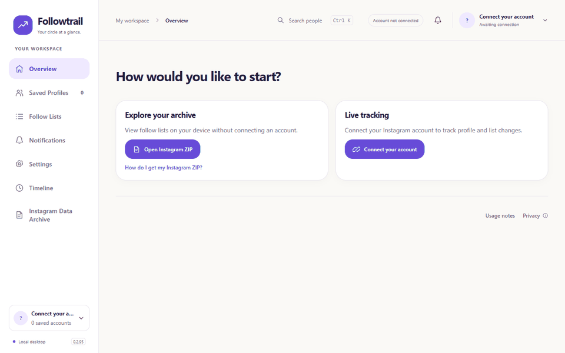

# Followtrail

[Türkçe](README.md) · [English](README.en.md) · [Español](README.es.md) · [Português (Brasil)](README.pt-BR.md)

**A local, open-source tool for your Instagram follow history.**

Review the data export you download from Instagram on your own device, and compare two exports to see who came and who left. If you choose, connect your account to keep a record of how your follow lists change over time. Your records stay encrypted on your computer.

[Download for Windows](https://github.com/KaanKaya17/Followtrail/releases/latest) · [Try it in your browser](https://kaankaya17.github.io/Followtrail/) · [User guide](docs/wiki/EN-Home.md) · [ZIP guide](docs/wiki/EN-Instagram-Data-Archive.md) · [Release status](docs/wiki/EN-Releases.md)

*Windows app with made-up sample data: open a ZIP → compare two exports → insights and year in review.*

> This project was previously published as **InstagramTracker**. Updating from an older version opens your existing records as they are.

## Read this first

Followtrail is not affiliated with Instagram or Meta and is not an official app.

- **ZIP mode** (recommended) reads the export you get from Instagram’s **Download your information**. It does not sign in, sends no request to Instagram, and the file never leaves your device.
- **Account mode** signs in with your account and uses Instagram interfaces that are not officially public. This may conflict with Instagram’s Terms of Use. Instagram may ask for extra verification, limit requests or restrict your account. Use it only if you accept that risk; the app keeps requests slow and limited but cannot guarantee anything.

Use it only with your own account and data you’re authorized to access, and respect other people’s privacy. The project does not support unauthorized access, harassment or unlawful use.

## What it does

**ZIP mode:** followers and following with follow dates; close friends, pending and received requests, recently unfollowed and other extra lists; comparing two exports (new, gone, likely username changes, search, CSV); summaries and search across the whole export.

**Account mode (Windows):** a regular record of your own follow lists, including people who **came back**, with the time window they were first and last seen; history of counts, usernames and bios for profiles you choose; change notifications and a timeline; an hourly and daily request quota on the **Overview**; and, if Instagram changes a read request, a pause, a notification and an optional report with no account data that you can post on GitHub.

**Both modes:** local storage encrypted with Windows DPAPI, separate vaults for several accounts, four languages and light, dark, OLED and system themes.

It cannot create history it never recorded, does not show profile visitors, and cannot follow, unfollow, like or send messages.

## Download

To try Followtrail without installing anything, use the [browser viewer](https://kaankaya17.github.io/Followtrail/): it opens the ZIP in your browser, uploads nothing, and the page cannot make network requests. It shows your follow lists, who doesn’t follow you back and a comparison of two ZIPs; Insights and the other archive sections are in the Windows app.

The [latest Windows release](https://github.com/KaanKaya17/Followtrail/releases/latest) is a portable x64 ZIP. Extract the whole ZIP to its own folder and run **Followtrail.exe** from there. The EXE is unsigned, so Windows SmartScreen may warn you; check the SHA-256 on the release page. Before updating, choose **Quit completely** from the tray icon.

With [Scoop](https://scoop.sh): `scoop bucket add followtrail https://github.com/KaanKaya17/Followtrail` and `scoop install followtrail`. [Package managers](packaging/README.md)

**Code signing policy:** Releases are built from this repository on GitHub Actions, tested before publishing and carry a build provenance attestation. They are not Authenticode-signed (the SignPath Foundation application was not accepted), so SmartScreen may warn on first launch; you can verify a download with its SHA-256 and build provenance. [How releases are built and verified](docs/CODE-SIGNING.en.md)

Current releases: **Windows 0.2.95** and the **Android 0.1.103** preview. Android is developed separately; see [release status](docs/wiki/EN-Releases.md). [All releases](https://github.com/KaanKaya17/Followtrail/releases) · [Changelog](CHANGELOG.md)

## Privacy

No project server, ads, analytics SDK or telemetry. ZIP files, passwords and account records are never sent to the project team. In account mode requests go directly to Instagram. An error report is shared only if you choose **Report on GitHub** or **Copy text**, and it contains no username or account ID. [Privacy and backups](docs/wiki/EN-Privacy.md) · [Security](SECURITY.md)

*Followtrail is independent of Instagram and Meta. Instagram is a trademark of Meta Platforms, Inc.*

[MIT license](LICENSE)
