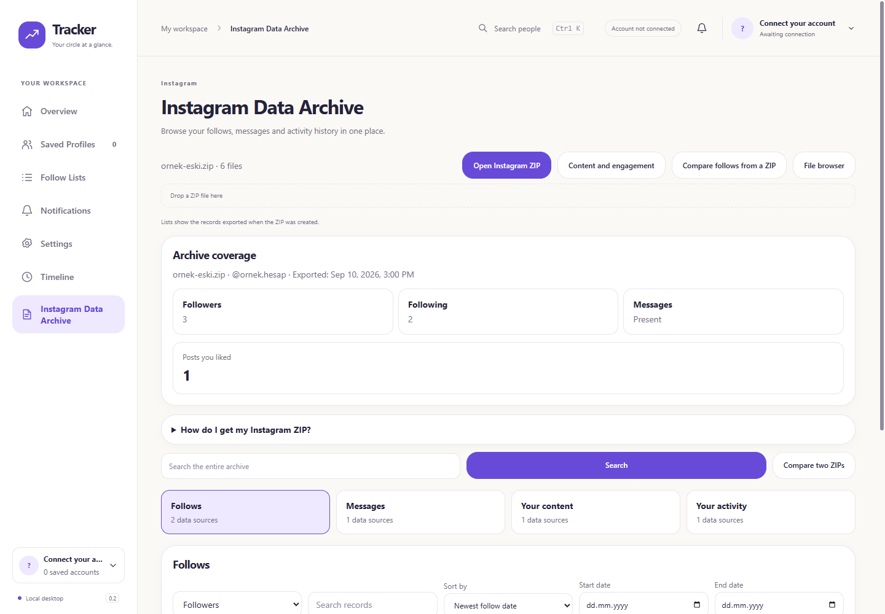

# InstagramTracker

[Türkçe](README.md) · [English](README.en.md) · [Español](README.es.md) · [Português (Brasil)](README.pt-BR.md)

Review Instagram archives, compare follower and following lists, and keep a local history of changes to the profiles you choose.

[Download the Windows preview](https://github.com/KaanKaya17/InstagramTracker-Downloads/releases/latest) · [Full user guide](docs/EN-Home.md) · [Illustrated ZIP guide](docs/EN-Instagram-Data-Archive.md) · [Release status](docs/EN-Releases.md)

## Choose how to start

- **Open a ZIP.** Use the official Instagram export to browse local data or compare two exports from the same account. No Tracker sign-in is needed.
- **Connect your account.** On Windows, track supported profile and list changes, review history and adjust notifications. Instagram verification and limits can affect requests.

The public Windows preview is a portable x64 ZIP. Extract the whole package and open **InstagramTracker.exe** from the extracted folder. The EXE is unsigned and SHA-256 is available on the release page. Android preview availability and the remaining sign-in validation are covered in [release status](docs/EN-Releases.md).

Records are stored locally with OS-backed encryption. ZIP processing stays on the device. Live reads go to Instagram. [Privacy and backups](docs/EN-Privacy.md) · [Support](docs/EN-Releases.md#support)

InstagramTracker is independent of Instagram and Meta.
