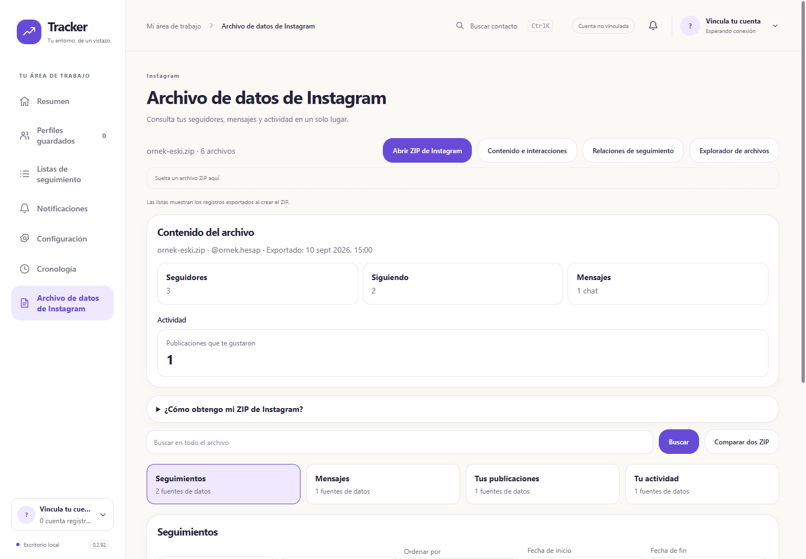

# Followtrail

[Türkçe](README.md) · [English](README.en.md) · [Español](README.es.md) · [Português (Brasil)](README.pt-BR.md)

**Una herramienta local y de código abierto para tu historial de seguidores en Instagram.**

Consulta en tu dispositivo la exportación que descargas de Instagram y compara dos exportaciones para ver quién llegó y quién se fue. Si quieres, vincula tu cuenta para registrar cómo cambian tus listas con el tiempo. Tus registros quedan cifrados en tu equipo.

[Descargar para Windows](https://github.com/KaanKaya17/Followtrail/releases/latest) · [Probar en el navegador (en inglés)](https://kaankaya17.github.io/Followtrail/) · [Guía en español](docs/wiki/ES-Home.md) · [Guía ilustrada del ZIP](docs/wiki/ES-Instagram-Data-Archive.md)

> Antes se publicaba como **InstagramTracker**. Al actualizar desde una versión anterior, tus registros se abren tal como estaban.

## Lee esto primero

Followtrail no está afiliado a Instagram ni a Meta y no es una app oficial.

- **Modo ZIP** (recomendado): lee la exportación de **Descargar tu información**. No inicia sesión, no envía solicitudes a Instagram y el archivo no sale de tu dispositivo.
- **Modo con cuenta**: inicia sesión y usa interfaces de Instagram que no son públicas oficialmente. Puede contradecir las Condiciones de uso de Instagram; Instagram puede pedir verificación, limitar solicitudes o restringir tu cuenta. Úsalo solo si aceptas ese riesgo.

Úsala solo con tu propia cuenta y con datos a los que tengas acceso autorizado. El proyecto no respalda el acceso no autorizado, el acoso ni el uso ilegal.

## Descarga

La [última versión para Windows](https://github.com/KaanKaya17/Followtrail/releases/latest) es un ZIP portátil x64. Extrae todo el ZIP en su propia carpeta y abre **Followtrail.exe**. El ejecutable no está firmado; comprueba el SHA-256 en la página de la versión.

Sin servidor propio, anuncios ni telemetría. *Followtrail es independiente de Instagram y Meta. Instagram es una marca de Meta Platforms, Inc.*

[Licencia MIT](LICENSE)
