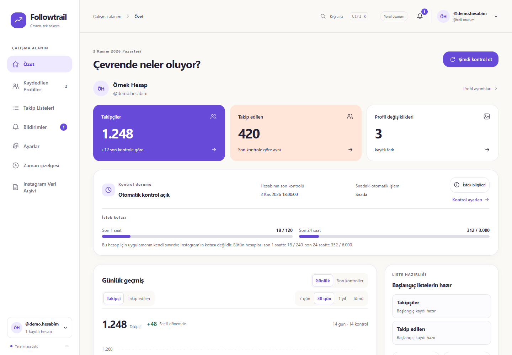
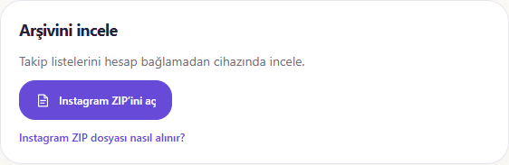

# Followtrail

[Türkçe](README.md) · [English](README.en.md) · [Español](README.es.md) · [Português (Brasil)](README.pt-BR.md)

**Instagram takip geçmişin için yerel ve açık kaynak bir araç.**

Instagram’dan indirdiğin veri arşivini cihazında incele, iki arşivi karşılaştırıp kimin geldiğini ve gittiğini gör. İstersen hesabını bağlayıp takip listelerinin zaman içindeki değişimini kaydet. Kayıtların bilgisayarında şifreli kalır.

[Windows sürümünü indir](https://github.com/KaanKaya17/Followtrail/releases/latest) · [Kullanım kılavuzu](docs/wiki/Home.md) · [ZIP rehberi](docs/wiki/Instagram-Veri-Arsivi.md) · [Sürüm durumu](docs/wiki/Surum-ve-Destek.md)



*Windows arayüzü, örnek verilerle gösterilmiştir.*

> Proje daha önce **InstagramTracker** adıyla yayımlandı. Eski sürümlerden güncellerken kayıtların olduğu gibi açılır.

## Önce bunu oku

Followtrail Instagram veya Meta ile bağlantılı değildir; resmî bir uygulama değildir.

- **ZIP modu** (önerilen): Instagram’ın **Bilgilerini indir** seçeneğiyle aldığın arşivi okur. Giriş yapılmaz, Instagram’a istek gönderilmez, dosya cihazından çıkmaz.
- **Hesap bağlamalı mod**: Hesabınla giriş yapar ve Instagram’ın resmî olarak herkese açmadığı arayüzlerini kullanır. Bu kullanım Instagram’ın kullanım şartlarıyla çelişebilir. Instagram ek doğrulama isteyebilir, istekleri sınırlayabilir veya hesabını kısıtlayabilir. Bu riski kabul ediyorsan kullan; uygulama istekleri yavaş ve sınırlı tutar ama bunu garanti edemez.

Yalnız kendi hesabını ve erişim yetkin olan verileri kullan. Başkalarının gizliliğine saygı göster. Proje izinsiz erişimi, tacizi ve yasa dışı kullanımı desteklemez.

## Hesap bağlamadan başla

İlk açılışta **Özet → Arşivini incele → Instagram ZIP’ini aç** yolunu izle ve Instagram’dan indirdiğin ZIP’i seç. Takipçilerini, takip ettiklerini, yakın arkadaşlarını, bekleyen isteklerini ve son takipten çıktıklarını görebilir; aynı hesabın iki ZIP’ini karşılaştırıp yeni gelenleri, gidenleri ve muhtemel ad değişikliklerini bulabilirsin. Sonuçları CSV olarak kaydedebilirsin. [ZIP’i alma ve karşılaştırma](docs/wiki/Instagram-Veri-Arsivi.md)



## Neler sunar?

**ZIP modunda**
- Takipçi ve takip edilen listeleri, takip tarihleriyle.
- Yakın arkadaşlar, bekleyen ve gelen istekler, son takipten çıktıkların ve diğer ek listeler.
- İki ZIP karşılaştırması: yeni gelenler, gidenler, muhtemel ad değişiklikleri, arama ve CSV.
- Beğeni, yorum, kayıt ve mesaj özetleri; arşivin tamamında arama.

**Hesap bağlamalı modda (Windows)**
- Kendi takip listelerinin düzenli kaydı; gelenler, gidenler ve **geri gelenler**, kişinin listede ilk ve son görüldüğü zaman aralığıyla.
- Seçtiğin profillerde sayaç, kullanıcı adı ve biyografi değişikliklerinin geçmişi, notlar ve favoriler.
- Değişiklik bildirimleri ve zaman çizelgesi.
- **Özet** ekranında saatlik ve günlük istek kotası: uygulamanın kendine koyduğu sınırın ne kadarının kullanıldığı.
- Instagram bir okuma yolunu değiştirirse otomatik okuma durur, bildirim gelir ve hesap verisi içermeyen bir hata raporunu istersen GitHub’da paylaşabilirsin.

**Her iki modda**
- Windows DPAPI ile şifreli yerel kayıt; birden fazla hesap için ayrı kasalar.
- Türkçe, English, Español ve Português (Brasil); açık, koyu, OLED ve sistem görünümü.

Uygulama hiç kaydetmediği bir geçmişi üretemez: ilk liste başlangıç kaydıdır. Profil ziyaretçilerini göstermez. Takip etme, takipten çıkma, beğenme veya mesaj gönderme özelliği yoktur. [Sık sorulan sorular](docs/wiki/Sik-Sorulan-Sorular.md)

## İndirme

[Windows için son sürüm](https://github.com/KaanKaya17/Followtrail/releases/latest) taşınabilir bir x64 ZIP’tir. ZIP’i ayrı bir klasöre tamamen çıkar ve **Followtrail.exe** dosyasını o klasörden çalıştır. EXE imzasız olduğu için Windows SmartScreen uyarı gösterebilir; sürüm sayfasındaki SHA-256 değeriyle dosyayı doğrulayabilirsin. Güncellerken önce sistem tepsisinden **Tamamen çık** seç.

Güncel sürümler: **Windows 0.2.95** ve **Android 0.1.103** önizlemesi. Android ayrı geliştiriliyor; durumu [sürüm sayfasında](docs/wiki/Surum-ve-Destek.md). [Tüm sürümler](https://github.com/KaanKaya17/Followtrail/releases) · [Değişiklik kaydı](CHANGELOG.md)

## Gizlilik

- Uygulamanın kendi sunucusu, reklamı, analitik SDK’sı veya telemetrisi yoktur.
- ZIP dosyaları, parolalar ve hesap kayıtları proje ekibine gönderilmez.
- Hesap bağlamalı modda istekler doğrudan Instagram’a gider.
- Hata raporu yalnız sen **GitHub’da bildir** veya **Metni kopyala** seçersen paylaşılır ve kullanıcı adı ya da hesap kimliği içermez.

[Gizlilik rehberi](docs/wiki/Gizlilik-ve-Veriler.md) · [Teknik notlar](docs/PRIVACY.md) · [Güvenlik bildirimi](SECURITY.md)

## Geliştiriciler için

Windows uygulaması Electron ve paketlenmiş bir Python worker’dan oluşur. Geliştirme, test ve paketleme adımları [Windows rehberinde](interface/DESKTOP.md), genel kurallar [CONTRIBUTING.md](CONTRIBUTING.md) dosyasındadır. [Teknik dokümantasyon](docs/README.md)

Android: JDK 21, Android SDK platform 36 ve build-tools 36.0.0.

```sh
./gradlew :app:testDebugUnitTest :app:lintRelease :app:assembleRelease
```

[Önceki README ve sürüm tarihçesi](docs/history/README-2026-11-02.md)

*Followtrail, Instagram ve Meta’dan bağımsız bir projedir. Instagram, Meta Platforms, Inc.’in ticari markasıdır.*

[MIT lisansı](LICENSE)
