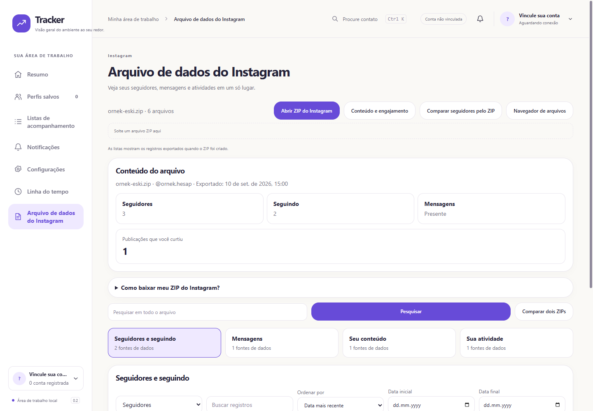

# InstagramTracker

[Türkçe](README.md) · [English](README.en.md) · [Español](README.es.md) · [Português (Brasil)](README.pt-BR.md)

Consulte exportações do Instagram, compare listas de seguidores e contas seguidas e veja o histórico local dos perfis escolhidos.

[Baixar para Windows](https://github.com/KaanKaya17/InstagramTracker-Downloads/releases/latest) · [Guia em português](docs/PT-BR-Home.md) · [Guia ilustrado do ZIP](docs/PT-BR-Instagram-Data-Archive.md)

Abra um ZIP oficial do Instagram para consultar seus dados sem vincular a conta. Com duas exportações da mesma conta, veja quais nomes só aparecem na versão antiga ou na nova. No Windows, você também pode vincular a conta para registrar alterações, histórico e notificações conforme o acesso permitido pelo Instagram.

A prévia pública do Windows é um ZIP portátil x64. Extraia o pacote inteiro e abra **InstagramTracker.exe**. O executável não tem assinatura. O SHA-256 está na página da versão. [Situação do Android e ajuda](docs/PT-BR-Home.md#instalação).

Os registros ficam criptografados no dispositivo. As leituras ao vivo se conectam ao Instagram. O InstagramTracker é independente do Instagram e da Meta.
