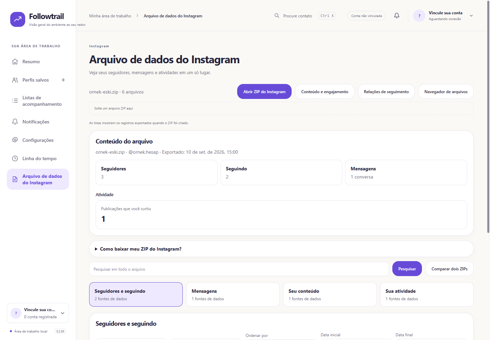

# Followtrail

[Türkçe](README.md) · [English](README.en.md) · [Español](README.es.md) · [Português (Brasil)](README.pt-BR.md)

**Uma ferramenta local e de código aberto para o seu histórico de seguidores no Instagram.**

Veja no seu dispositivo a exportação que você baixa do Instagram e compare duas exportações para saber quem chegou e quem saiu. Se quiser, conecte sua conta para registrar como suas listas mudam com o tempo. Seus registros ficam criptografados no seu computador.

[Baixar para Windows](https://github.com/KaanKaya17/Followtrail/releases/latest) · [Guia em português](docs/wiki/PT-BR-Home.md) · [Guia ilustrado do ZIP](docs/wiki/PT-BR-Instagram-Data-Archive.md)

> Antes era publicado como **InstagramTracker**. Ao atualizar de uma versão anterior, seus registros abrem como estavam.

## Leia isto primeiro

O Followtrail não é afiliado ao Instagram nem à Meta e não é um app oficial.

- **Modo ZIP** (recomendado): lê a exportação de **Baixar suas informações**. Não faz login, não envia solicitações ao Instagram e o arquivo não sai do seu dispositivo.
- **Modo com conta**: faz login e usa interfaces do Instagram que não são públicas oficialmente. Isso pode contrariar os Termos de Uso do Instagram; o Instagram pode pedir verificação, limitar solicitações ou restringir sua conta. Use apenas se aceitar esse risco.

Use somente com sua própria conta e com dados que você tem autorização para acessar. O projeto não apoia acesso não autorizado, assédio ou uso ilegal.

## Download

A [versão mais recente para Windows](https://github.com/KaanKaya17/Followtrail/releases/latest) é um ZIP portátil x64. Extraia o ZIP inteiro em uma pasta própria e abra **Followtrail.exe**. O executável não é assinado; confira o SHA-256 na página da versão.

Sem servidor próprio, anúncios ou telemetria. *O Followtrail é independente do Instagram e da Meta. Instagram é uma marca da Meta Platforms, Inc.*

[Licença MIT](LICENSE)
