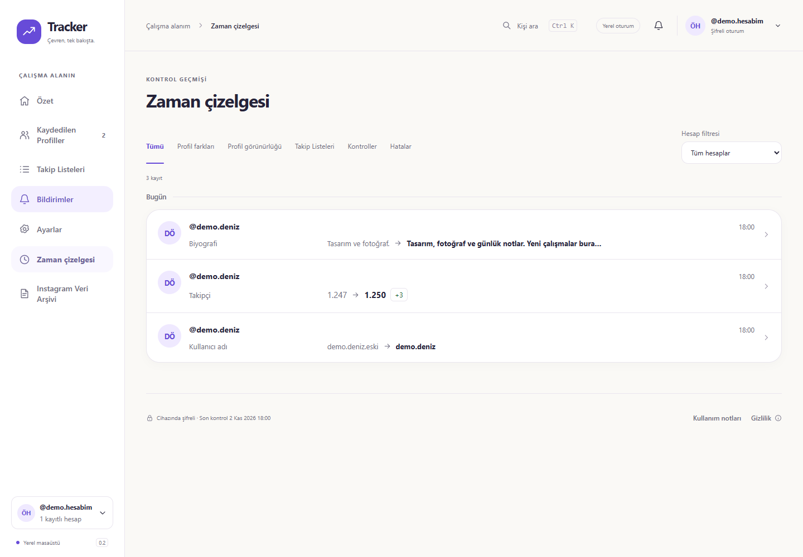

# Timeline and profile history

[User guide](EN-Home.md) · [Daily statistics](EN-Daily-Statistics.md) · [FAQ](EN-FAQ.md)

## Timeline

Use **Timeline** to see changes, checks and failures. Filter by account or type where available. A timestamp usually shows when Tracker observed the change. A failed check means Tracker has no new observation from that attempt.

The counter chart shows saved observations. The **Daily** view preserves daily summaries after detailed observations are pruned. Missing observations stay missing.

## Profile Time Tunnel

Enable archiving for the selected profile to keep available biographies and profile pictures. The first saved record is the baseline. Later biographies can highlight inserted words in green with a plus mark and removed words in red with a minus mark. The avatar gallery contains images that Tracker was able to save. Pausing stops new archiving. Clearing removes that profile’s archive.

Choose two recorded observations in the profile comparison. View the old and new biography and available name, photo, links and counters side by side. Unavailable fields stay unknown. The comparison stays local. Use Timeline for changes recorded between the two snapshots.

## About this account

The **About this account** panel can store the visible join month and year, country and number of username changes that you saw in Instagram. These fields are entered manually. Saving an empty field clears that local entry.

## Possible blocks and visibility

Windows can combine a previously complete list, a current profile check and, where available, a signed-out visibility check against the last known username. The result shows a suspicion and its basis. A block, account closure or deactivation, username change and access limits can produce similar signs. Android coverage can differ. Tracker does not reveal profile visitors, hidden stories or exact event times.
