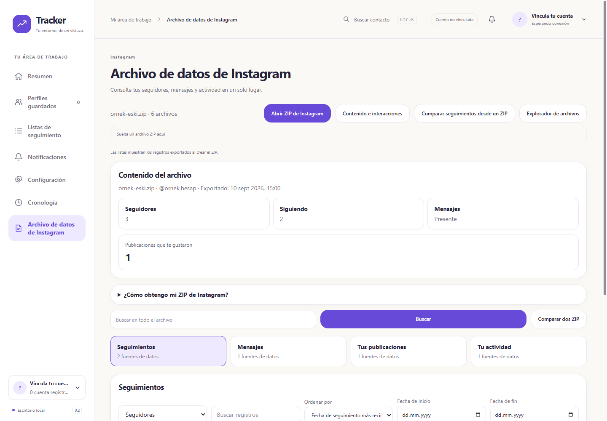
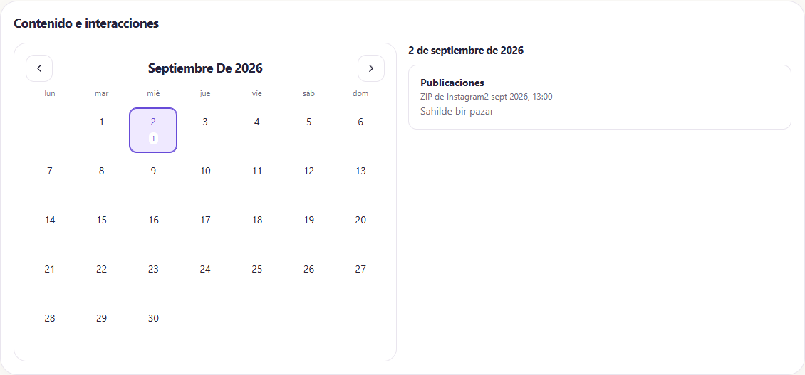
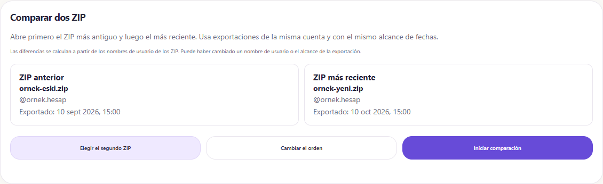
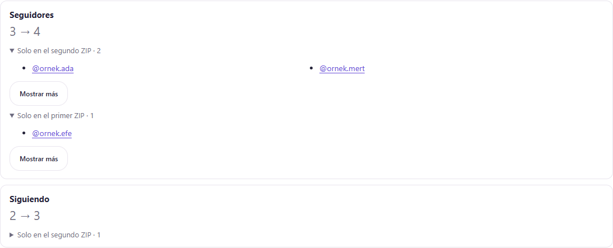

# Archivo de datos de Instagram

[Guía](ES-Home.md) · [English](EN-Instagram-Data-Archive.md) · [Türkçe](Instagram-Veri-Arsivi.md) · [Português (Brasil)](PT-BR-Instagram-Data-Archive.md)

Abre un ZIP de Instagram para consultar listas, mensajes y actividad en el dispositivo. Puedes comparar dos exportaciones de una misma cuenta sin vincularla en Tracker. Las capturas muestran Windows 0.2.84 con datos de ejemplo.

## Descarga el ZIP

1. Abre el Centro de cuentas desde la ayuda de la pantalla de archivo. En **Tu información y permisos → Exportar tu información**, elige el perfil de Instagram y la opción de exportar al dispositivo.
2. Incluye **Seguidores y seguidos** en ambas exportaciones. Agrega mensajes, actividad o contenido multimedia si los quieres consultar.
3. Selecciona **JSON** y **Desde el principio** o **Todo el tiempo**, según la etiqueta que muestre Instagram. Usa el mismo alcance en ambas exportaciones. Descarga los archivos cuando estén listos.

## Abre el archivo

En Windows, usa **Resumen → Abrir ZIP de Instagram** al iniciar. Después puedes entrar en **Archivo de datos de Instagram**, debajo de **Cronología**, o arrastrar el ZIP a la zona de carga. En Android, la ubicación depende de la versión. Consulta [la guía](ES-Home.md#instalación).

**Contenido del archivo** muestra la cuenta y la fecha si están disponibles. **No está en este ZIP** indica que la fuente no aparece en el archivo. **0** indica una lista vacía que se pudo leer. Si la lectura falla, descarga de nuevo la exportación. Usa las categorías, **Buscar en todo el archivo** o el **Explorador de archivos** para localizar registros. **Contenido e interacciones** organiza por fecha las publicaciones, Reels e historias disponibles. La vista previa y los recuentos dependen de lo que incluya el ZIP.

## Compara dos ZIP

1. Abre el ZIP más antiguo. Selecciona **Comparar dos ZIP → Elegir el segundo ZIP** y elige el más reciente.
2. Revisa las tarjetas de las dos fuentes. Si quedaron al revés, usa **Cambiar el orden**. Si los nombres de cuenta difieren, confirma que elegiste las exportaciones correctas y comprueba si hubo un cambio de nombre.
3. Selecciona **Iniciar comparación**.

## Lee los resultados

Abre **Solo en el primer ZIP** o **Solo en el segundo ZIP** en la sección de seguidores o de cuentas seguidas.

En el ejemplo, el recuento pasa de **3 a 4**. Dos nombres aparecen solo en el ZIP nuevo y uno solo en el antiguo. Incluso con el mismo total, pueden cambiar los integrantes. La comparación usa nombres de usuario, así que un cambio de nombre o de alcance puede alterar el resultado. Hace falta la misma lista en ambos archivos para compararla. Los ZIP no muestran la hora exacta del cambio ni los cambios revertidos entre las dos exportaciones.
