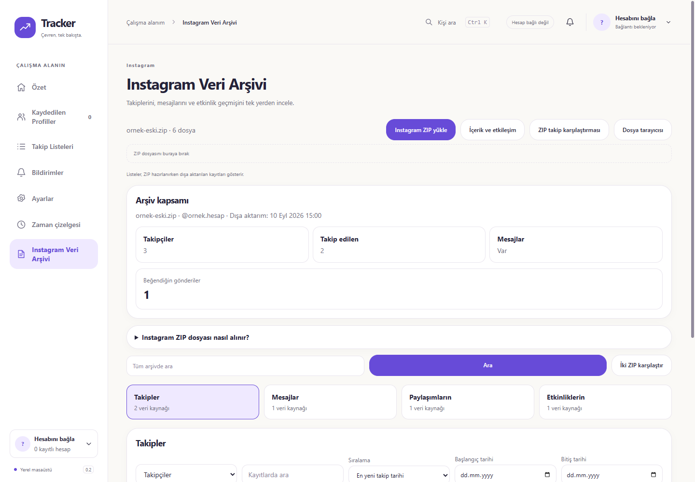
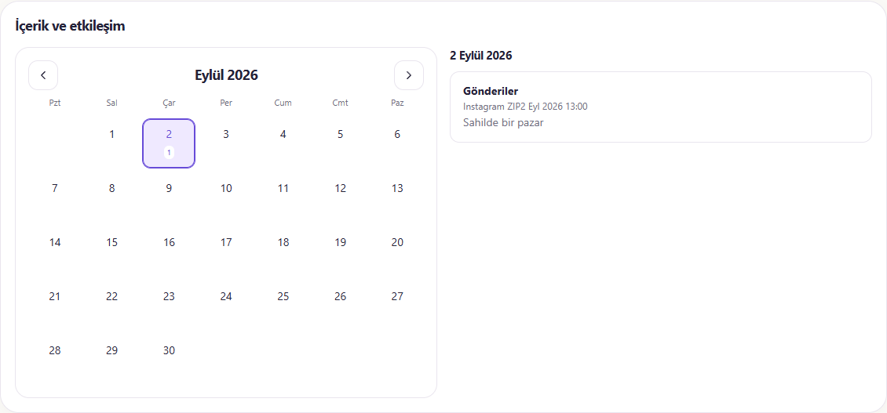
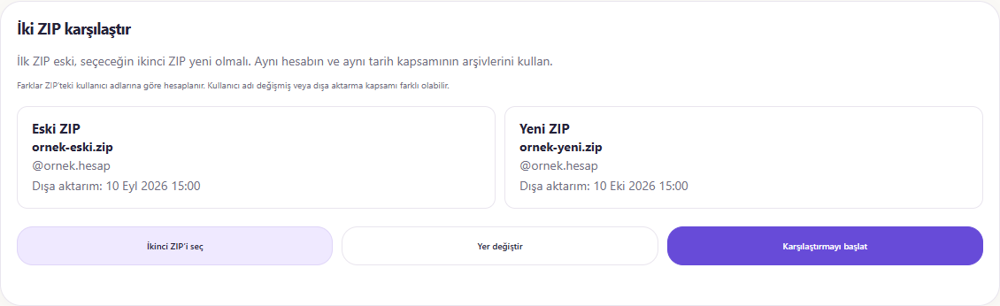
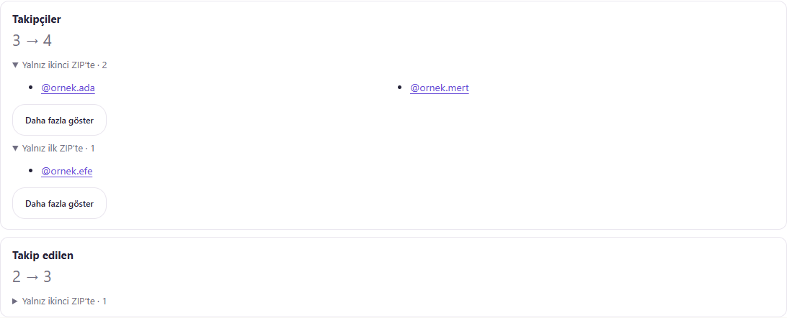

# Instagram Veri Arşivi

[İndirme ve kurulum](../README.md)

Instagram’dan indirdiğiniz ZIP’i Tracker’da açarak takip listelerinizi, mesajlarınızı ve etkinlik kayıtlarınızı inceleyebilirsiniz. Aynı hesabın iki ZIP’i varsa takip listelerini karşılaştırabilirsiniz. Dosyalar cihazda okunur ve bu işlemler için Tracker’a Instagram hesabı bağlamanız gerekmez.

Görseller Windows 0.2.84’te örnek ZIP’lerle çekildi.

[ZIP’i alın](#zip-dosyasini-alin) · [Arşivi açın](#arsivi-acip-inceleyin) · [İki ZIP’i karşılaştırın](#iki-zipi-karsilastirin) · [Sonucu okuyun](#sonucu-okuyun)

## 1. ZIP dosyasını alın

1. Tracker’da **Instagram ZIP dosyası nasıl alınır?** bağlantısını açın. Kılavuzdaki **Hesaplar Merkezi’ni aç** düğmesi Instagram’ın dışa aktarma ayarlarına götürür.
2. Dışa aktaracağınız Instagram hesabını seçin ve dosyayı **cihaza** aktarmayı seçin. İki ZIP’i karşılaştıracaksanız **Takipçiler ve takip edilenler** verisini her iki dışa aktarımda da seçin. Mesaj, etkinlik veya medya incelemek için ilgili kategorileri de seçebilirsiniz.
3. Biçimi **JSON**, tarih aralığını **Tüm zamanlar** seçin. Karşılaştıracağınız dosyalarda aynı seçimleri kullanın.
4. Instagram dosyayı hazırladığında indirin. Tracker’da doğrudan ZIP’i seçebilirsiniz.

## 2. Arşivi açıp inceleyin

Windows’ta ilk açılışta **Özet → Instagram ZIP’ini aç** yolunu kullanın. Daha sonra sol menüde **Zaman çizelgesi** altından **Instagram Veri Arşivi**’ne gidebilir, **Instagram ZIP yükle** düğmesini kullanabilir veya dosyayı bırakma alanına sürükleyebilirsiniz.

- **Arşiv kapsamı** dosya adını ve bulunabildiğinde hesap adını ve dışa aktarım tarihini gösterir. **Bu ZIP’te yok** ilgili kaynağın dosyada bulunmadığını, **0** ise takip listesinin okunabildiğini ve boş geldiğini belirtir. **Okunamadı** görünen kayıtlarda kaynak dosyayı yeniden indirmeyi deneyin.
- **Takipler**, **Mesajlar** ve **Etkinliklerin** gibi kategoriler ZIP’in içeriğine göre görünür. **Tüm arşivde ara** ile okunabilir kayıt alanlarına, **Dosya tarayıcısı** ile tek bir dosyaya ulaşabilirsiniz.
- **İçerik ve etkileşim** takviminde bir gün seçin. ZIP’te o güne ait gönderi, Reels veya hikâye varsa görüntülenir. Medya ve etkileşim sayıları ilgili dosyalar arşivde bulunduğunda açılır.

## 3. İki ZIP’i karşılaştırın

1. Önce **eski ZIP’i** açın. Arşivde **İki ZIP karşılaştır → İkinci ZIP’i seç** yolunu izleyip yeni dosyayı seçin.
2. **Eski ZIP** ve **Yeni ZIP** kartlarını kontrol edin. Hesap adları ile dışa aktarım tarihleri varsa burada görünür. Dosyalar ters sıradaysa **Yer değiştir**’e tıklayın.
3. **Karşılaştırmayı başlat**’a tıklayın. Hesap adları farklı görünürse önce doğru dosyaları seçtiğinizi ve varsa kullanıcı adı değişikliğini kontrol edin.

## 4. Sonucu okuyun

**Takipçiler** ve **Takip edilen** ayrı sonuçlar verir. **Yalnız ilk ZIP’te** ve **Yalnız ikinci ZIP’te** başlıklarını açarak kullanıcı adlarını görebilirsiniz.

Örnekte takipçi sayısı **3 → 4**. İki kullanıcı adı yalnız yeni arşivde, bir kullanıcı adı yalnız eski arşivde bulunuyor. Toplam sayı aynı kalsaydı bile bu başlıklar iki listede yer değiştiren üyeleri gösterebilirdi. Farklar kullanıcı adına göre hesaplanır. Kullanıcı adı değişikliği veya dışa aktarım kapsamındaki fark sonucu etkileyebilir.

Bir liste iki dosyadan birinde eksikse o yön için karşılaştırma yapılamadığı gösterilir. İki arşiv yalnız dışa aktarıldıkları andaki kayıtları karşılaştırır. Arada kısa süreli gerçekleşip geri alınan değişiklikler ve kesin olay zamanı bu dosyalardan belirlenemez.
