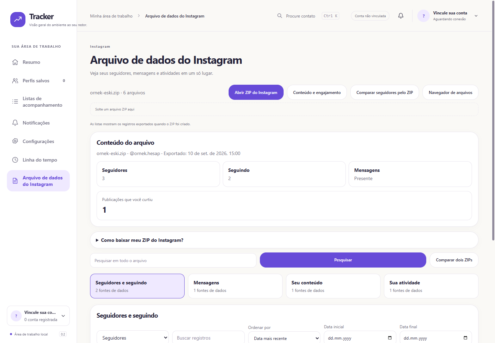
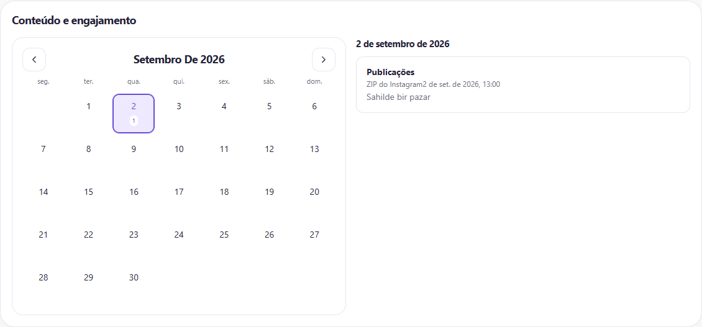
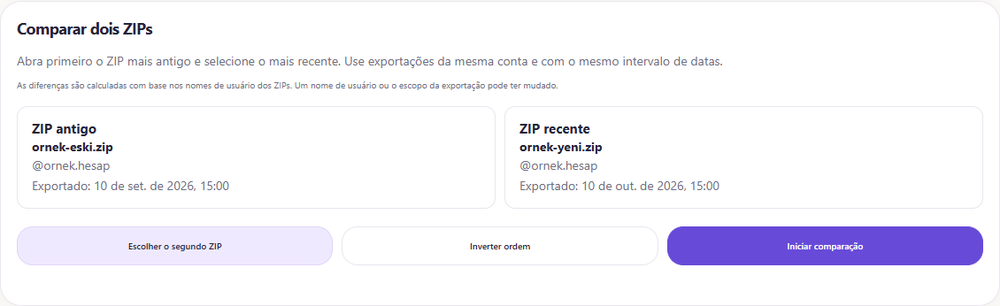
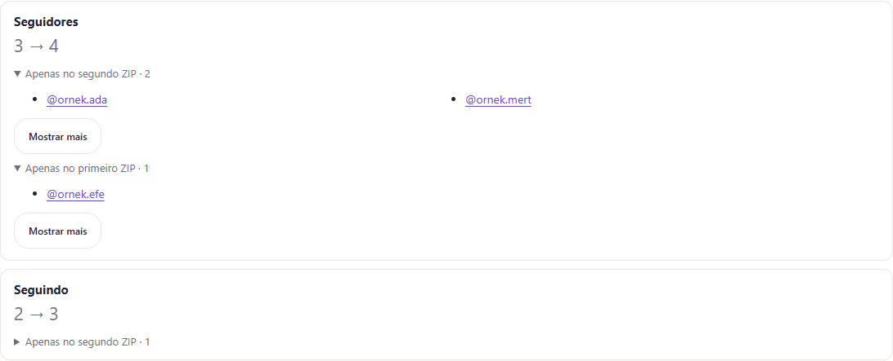

# Arquivo de dados do Instagram

[Guia](PT-BR-Home.md) · [English](EN-Instagram-Data-Archive.md) · [Türkçe](Instagram-Veri-Arsivi.md) · [Español](ES-Instagram-Data-Archive.md)

Abra um ZIP do Instagram para consultar listas, mensagens e atividades no dispositivo. Compare duas exportações da mesma conta sem vinculá-la ao Tracker. As capturas mostram o Windows 0.2.84 com dados de exemplo.

## Baixe o ZIP

1. Abra a Central de Contas pelo link de ajuda na tela do arquivo. Em **Suas informações e permissões → Exportar suas informações**, escolha o perfil do Instagram e a exportação para o dispositivo.
2. Inclua **Seguidores e contas que você segue** nas duas exportações. Se quiser consultar mensagens, atividades ou mídia, selecione essas categorias também.
3. Escolha **JSON** e **Todo o período**. Mantenha as mesmas opções nos dois pedidos. Quando os arquivos estiverem prontos, baixe os ZIPs.

## Abra o arquivo

No Windows, use **Resumo → Abrir ZIP do Instagram** na primeira abertura. Depois, acesse **Arquivo de dados do Instagram** abaixo de **Linha do tempo**, ou arraste o ZIP para a área indicada. No Android, o caminho depende da versão. Consulte [o guia](PT-BR-Home.md#instalação).

**Conteúdo do arquivo** mostra a conta e a data quando disponíveis. **Não está neste ZIP** indica que a fonte não veio no arquivo. **0** indica que uma lista vazia foi lida. Se a leitura falhar, tente baixar a exportação novamente. Use as categorias, **Pesquisar em todo o arquivo** ou o **Navegador de arquivos** para localizar registros. **Conteúdo e engajamento** organiza publicações, Reels e stories por data. As prévias e contagens dependem dos dados do ZIP.

## Compare dois ZIPs

1. Abra o ZIP mais antigo. Selecione **Comparar dois ZIPs → Escolher o segundo ZIP** e abra o mais recente.
2. Confira os cartões das duas fontes. Se tiver escolhido na ordem inversa, use **Inverter ordem**. Se os nomes da conta forem diferentes, confira os arquivos e se houve mudança de nome.
3. Selecione **Iniciar comparação**.

## Leia os resultados

Na seção de seguidores ou contas seguidas, abra **Apenas no primeiro ZIP** ou **Apenas no segundo ZIP** para ver os nomes.

O exemplo passa de **3 para 4** seguidores. Dois nomes aparecem só no arquivo novo e um aparece só no antigo. As pessoas podem mudar mesmo quando o total permanece igual. A comparação usa nomes de usuário e pode ser afetada por renomeações ou por diferenças nas opções de exportação. A lista precisa estar disponível nos dois arquivos para ser comparada. Os ZIPs não mostram o horário exato da mudança ou mudanças revertidas entre as exportações.
