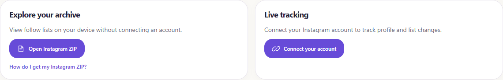

# Getting started

[User guide](EN-Home.md) · [Account connection](EN-Accounts.md) · [Instagram Data Archive](EN-Instagram-Data-Archive.md)

On **Overview**, choose **Open Instagram ZIP** to inspect an export on your device, or **Connect your account** to set up live monitoring. The full archive shortcut and ZIP comparison are available in Windows 0.2.75 and Android 0.1.96 onward. Check [download availability](EN-Releases.md) for your platform.

## Connect an account

Complete any Instagram verification, then wait for Followtrail to read your own profile. When your profile and counters appear, Followtrail can begin the first list preparation. Android can also show a [pending connection](EN-Accounts.md#finish-a-pending-connection) after Instagram sign-in.

## First list preparation

- **Preparing** means Followtrail is reading and storing list pages.
- **Waiting** means a request interval, budget or Instagram cooldown is in effect.
- **Paused** means an action or setting may be needed. Review the explanation and use the resume action if available.
- **Ready** means the first complete snapshot exists for that direction.

Updates preserve automation preferences. A first complete snapshot provides the baseline for a later comparison. [How list comparisons work](EN-Follow-Lists.md#first-snapshot-and-later-comparisons).

## Find your way around

- **Overview** shows your counters, list preparation and recent activity.
- **Saved Profiles** contains people you add for tracking, notes or favorites.
- **Follow Lists** contains saved follower and following lists and comparisons.
- **Notifications** shows changes grouped by check on Windows.
- **Timeline** shows changes, checks and errors in chronological order.
- **Instagram Data Archive** opens a ZIP, content calendar or comparisons.
- **Settings** contains appearance, language, automation and local data options.

## Start tracking a profile

Use **Saved Profiles → Add person**, search by name or username, or paste a profile link. Select the right result and enable **Watch profile** for periodic checks. Then choose the [types of notifications](EN-Monitoring.md#notification-preferences) you want. Saving a profile only changes Followtrail’s local records.

Followtrail supports Turkish, English, Spanish and Brazilian Portuguese. Choose your app language and the system, light, dark or OLED theme in settings.
