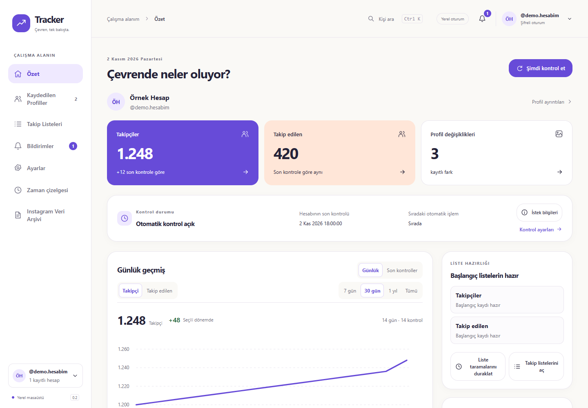

# InstagramTracker User Guide

[English](EN-Home.md) · [Türkçe](Home.md) · [Español](ES-Home.md) · [Português (Brasil)](PT-BR-Home.md)

InstagramTracker lets you inspect Instagram exports, compare follow lists, and keep a local history of changes to selected profiles.

The screenshots use synthetic data. Some labels in shared screenshots are in Turkish.

## Get started

- [Install or update](EN-Installation.md) on Windows or Android.
- [Open an Instagram ZIP or compare two exports](EN-Instagram-Data-Archive.md) without connecting an Instagram account.
- [Set up live tracking](EN-Getting-Started.md) and check when the first follow lists are ready.

## Explore the guide

- [Accounts and sign-in](EN-Accounts.md) covers verification, pending connections and multiple accounts.
- [Saved profiles](EN-Saved-Profiles.md) covers search, favorites, notes and shortcuts.
- [Follow lists](EN-Follow-Lists.md) covers complete and partial snapshots, common accounts and exceptions.
- [Automatic checks and notifications](EN-Monitoring.md) covers timing and background operation.
- [Timeline and profile history](EN-History.md), [daily statistics](EN-Daily-Statistics.md) and [story archive](EN-Story-Archive.md) explain what each record shows.
- [Privacy, backups and deletion](EN-Privacy.md) explains where information goes and how to manage it.
- [Troubleshooting](EN-Troubleshooting.md), [FAQ](EN-FAQ.md) and [releases and support](EN-Releases.md) cover errors and platform availability.

For maintainers, see [Preparing the GitHub Wiki](EN-Wiki-Publishing.md).
