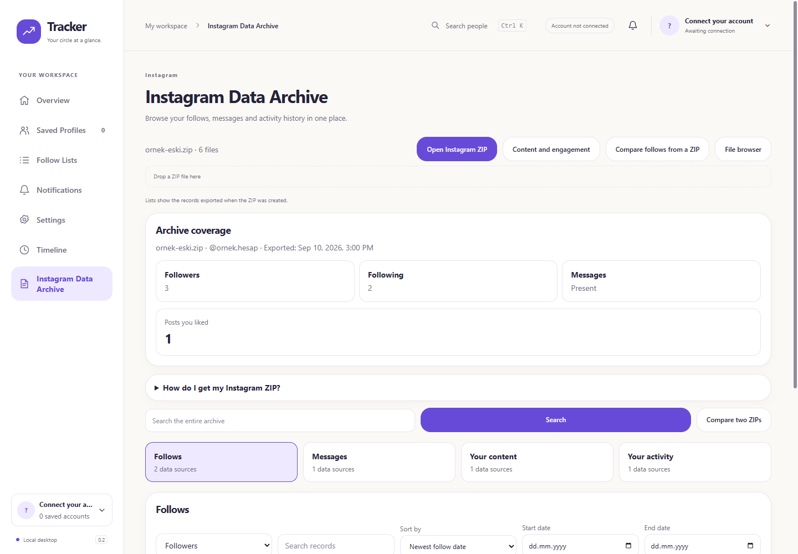
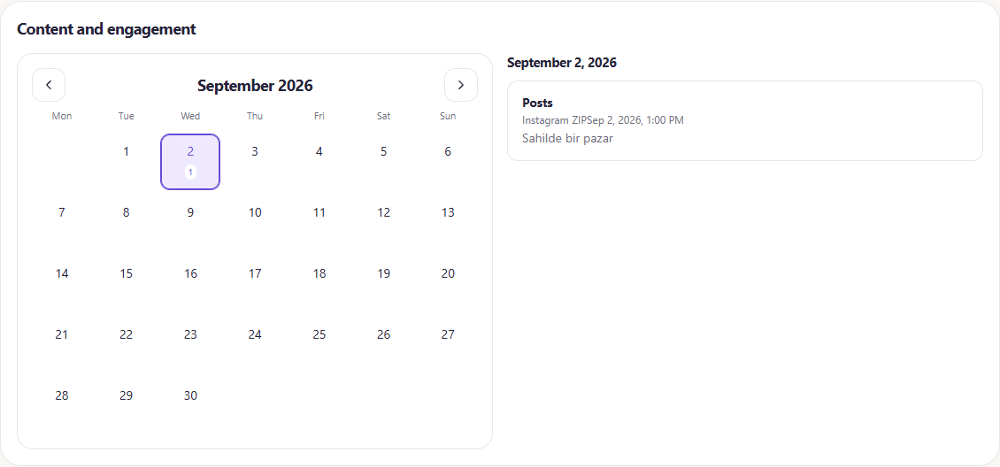
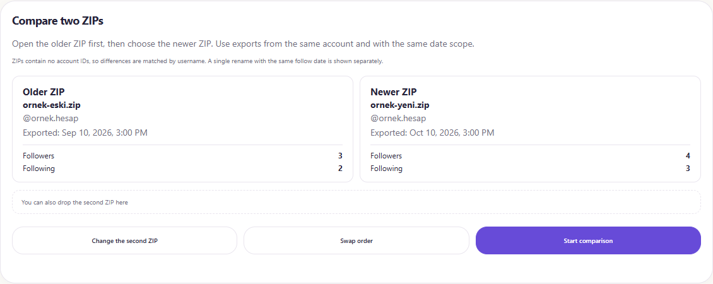
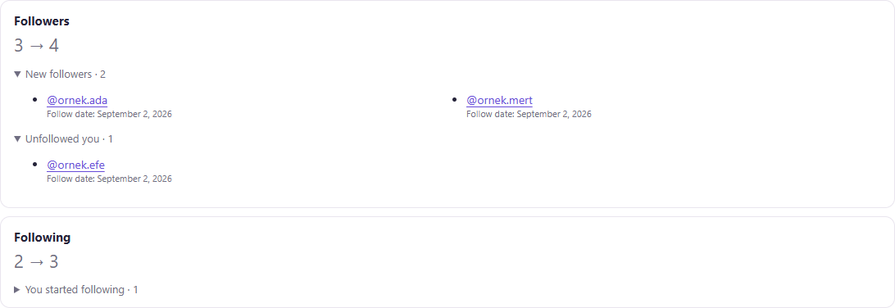

# Instagram Data Archive

[User guide](EN-Home.md) · [Installation](EN-Installation.md) · [Follow lists](EN-Follow-Lists.md)

Open a ZIP from Instagram to browse available follow lists, messages and activity on your device. Compare two exports for the same account without connecting Instagram to Tracker. These screenshots show Windows 0.2.84 with synthetic data.

[Get a ZIP](#get-a-zip) · [Open the archive](#open-the-archive) · [Compare two ZIPs](#compare-two-zips) · [Read results](#read-results)

## Get a ZIP

1. In Tracker, use the help link under **Open Instagram ZIP** or in **Instagram Data Archive** to open Meta Accounts Center.
2. Under **Your information and permissions → Export your information**, select your Instagram account and export to your device. Include **Followers and following** in both exports for a comparison. Select messages, activity or media if you also want to browse them.
3. Choose **JSON** and **All time**. Use the same selections for both exports. Once Instagram prepares the files, download them. Tracker opens the ZIP as downloaded.

## Open the archive

On Windows, use **Overview → Open Instagram ZIP** on first launch. Later, open **Instagram Data Archive** below **Timeline** and select **Open Instagram ZIP** or drag the file onto the drop area.

On Android 0.1.100, use the ZIP action on the first screen. The older 0.1.92 preview opens the relationship lists through the options menu. See [release status](EN-Releases.md#android).

- **Archive coverage** shows the file name, account and export date when available. **Missing from this ZIP** means the category was absent. A count of **0** means Tracker read an empty list. When a list could not be read, try a fresh export.
- Use categories to explore the available items, **Search the entire archive** to find readable fields, or **File browser** to inspect or save an individual file. Supported local media can be previewed.
- **Content and engagement** opens a calendar. Select a day to see posts, Reels or stories available in the export. Media and engagement counts depend on the archive. When applicable, the calendar can also show your linked account’s local story records.

## Compare two ZIPs

1. Open the older ZIP. Choose **Compare two ZIPs → Choose the second ZIP** and select the newer ZIP.
2. Check both source cards. Compare the account names and dates when shown. Use **Swap order** if the newer file is first.
3. Select **Start comparison**. If Tracker displays an account mismatch, check the files and any username change before interpreting the result.

## Read results

Expand **Only in the first ZIP** or **Only in the second ZIP** under **Followers** or **Following** to view usernames.

Here the count is **3 → 4**. Two usernames appear only in the newer export and one appears only in the older export. A replacement can appear even if the total stays the same. Matching is based on usernames, so renames or different export settings can change the result. A direction absent from either ZIP cannot be compared. The result shows differences between two snapshots. Their exact event times and changes that were reversed in between are unknown.

For profiles monitored live, use [Follow Lists](EN-Follow-Lists.md) to compare snapshots collected after connecting.
