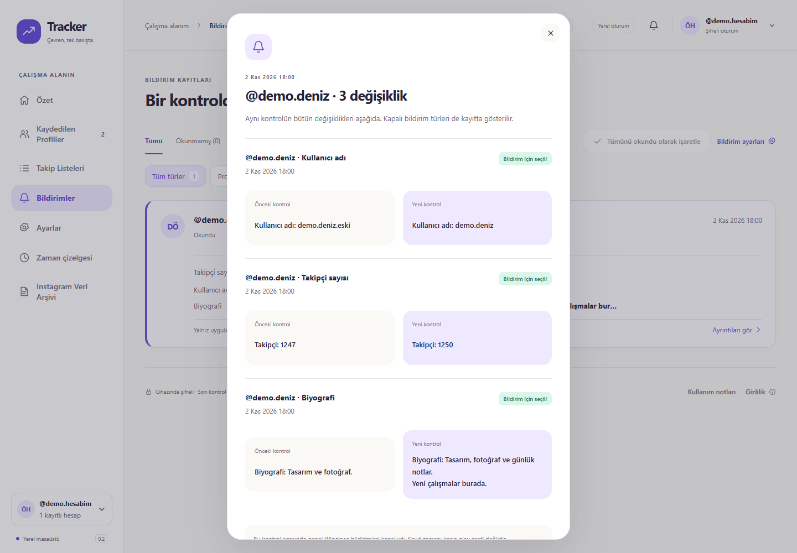

# Automatic checks and notifications

[User guide](EN-Home.md) · [Follow lists](EN-Follow-Lists.md) · [Release status](EN-Releases.md)

## Windows

In **Settings**, enable automatic profile checks and, if needed, automatic follow-list comparisons. Turn on **Watch profile** for each saved person you want to monitor. The default profile interval is five minutes, evaluated per profile. The shared queue and connection can affect actual timing. A full list scan can require multiple requests.

Tracker can keep monitoring in the Windows system tray while the computer is awake and online. Locking Windows still allows checks if the machine stays awake. **Quit completely**, sleep and shutdown stop checks. A disconnected computer cannot perform new checks.

## Android

For your own profile, open **Options → Check settings**. The default profile interval is five minutes and the setting can be adjusted. The Android background job is scheduled in 15-minute periods when background monitoring is enabled. Android can delay execution for system and battery conditions. Selecting one or five minutes does not change the system’s 15-minute job period. An active **Quick watch** session targets about one minute. Full list scans have their own timing.

## Request pacing

Normal counted requests use a shared 6–10 second spacing range and local rolling budgets. The account limit is 120 per hour and 3,000 per 24 hours. The device-wide limits are 240 and 6,000. Automatic profile work is deferred at 80% of its applicable budget. Restrictions and Instagram’s responses apply independently. [Request policy](../REQUEST-POLICY.md).

## Notification preferences

On Windows, choose notification types per account. For example, enable username and biography updates while muting follower counts. Changes from one check are grouped. **Notifications** shows old and new values. Muted types can still appear in the local log. System delivery depends on your OS notification settings and the app state.

If a notification is missing, check the in-app log, the watch and automation settings, the notification type, OS permissions, connectivity and cooldowns. Notifications only apply to changes observed after a usable baseline. [Troubleshooting](EN-Troubleshooting.md#notifications-are-missing).
