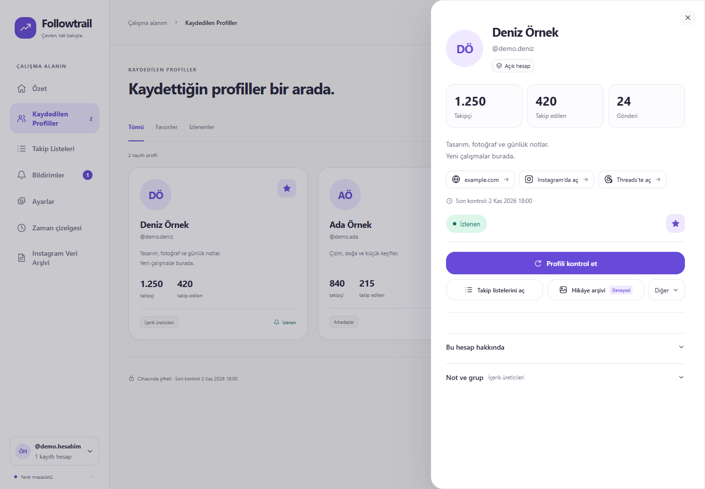

# Saved profiles

[User guide](EN-Home.md) · [Follow lists](EN-Follow-Lists.md) · [History](EN-History.md)

## Add and organize profiles

**Saved Profiles** contains profiles you choose to track. Use **Follow Lists** to see the members of a saved relationship list. To add a profile, choose **Add person**, type part of the name or username, or paste a profile link. For example, you can enter an example username with or without the leading @. Select the correct result. After a short typing pause, the latest pending search can enter the request queue. Searching the already saved profiles filters local names and groups on your device.

Enable **Watch profile** to include a person in periodic checks. Mark favorites for quick access, and use notes or groups to organize them. Saving, organizing and removing profiles only affects Followtrail’s records. See [deletion scope](EN-Privacy.md#deletion-and-disconnection).

## Read the profile panel

On Windows, opening a list entry can queue one profile read to fill missing or stale details. Verified information can be reused for up to five minutes where applicable. An explicit refresh asks for fresh data. The panel shows available follower, following and post counts and visibility. Missing values remain unknown, and an initial can appear when the photo is unavailable.

Website links show a local icon and site name. Hover on Windows or long-press on Android to inspect the address. Tapping a link opens it in your regular browser. A Threads shortcut appears when the Instagram profile supplies an explicit Threads URL or an active Threads badge with a valid name. An explicit URL takes priority. Followtrail does not query Threads separately to verify the button. See [FAQ](EN-FAQ.md).

## Windows keyboard shortcuts

- **Ctrl+K** or **/** opens the local search palette for saved profiles, accounts and screens.
- **Ctrl+R** refreshes the selected profile where the screen supports it.
- **1–5** opens Overview, Saved Profiles, Follow Lists, Notifications or Settings.
- **Esc** closes the topmost palette, dialog or panel.

Focus, open forms, pending operations and cooldowns affect availability. Use the operation’s cancel action to cancel a running request.
