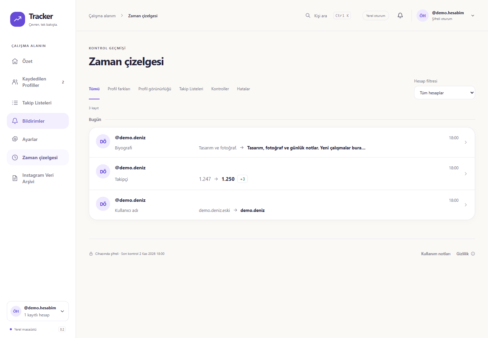

# Geçmiş ve Analiz

[Kılavuz ana sayfası](Home.md) · [Sık sorulan sorular](Sik-Sorulan-Sorular.md)

## Zaman çizelgesi

Zaman çizelgesi, uygulamanın hangi kontrolde ne gördüğünü bir araya getirir. Bir satırın zamanı genellikle **değişikliğin gözlendiği zamandır**. Kişinin işlemi tam o saniyede yaptığı anlamına gelmez.

Önceki ve sonraki değerleri birlikte okuyun. Bir kontrol başarısız olduğunda kaydın güncellenmemesi, hesabın değişmediğini kanıtlamaz; yalnız yeni gözlem alınamadığını gösterir.

## Sayaç grafikleri

Takipçi/takip edilen grafikleri kaydedilmiş gözlemlerden oluşur. Kontroller arasında bilinmeyen hareketler olabilir. Net artış, o aralıktaki bütün ekleme ve çıkışların sayısı değildir.

Ayrıntılı sayaç geçmişi sınırlı sayıda kayıt tutar. Sık kontrol, saklanan zaman aralığını kısaltır. Bu sınıra ulaşılsa da ayrı saklanan [günlük istatistikler](Gunluk-Istatistikler.md) otomatik silinmez. Uzun dönem için Günlük görünümünü kullanın; Son kontroller ayrıntılı ve sınırlı pencereyi gösterir. Hiç gözlenmemiş günler sonradan oluşturulmaz.

## Profil zaman tüneli

Profil zaman tüneli, sayı geçmişinden ayrı olarak biyografi ve avatar değişikliklerini incelemek içindir. Kullanılacak profil için arşiv kaydını açıkça etkinleştirin.

- **Biyografi farkı:** Silinen ve eklenen metinleri karşılaştırır.
- **Avatar galerisi:** Özellik açıkken başarıyla alınan profil görsellerini yerel arşivde tutar.
- **Durdurma:** Yeni arşivlemeyi durdurur; mevcut kayıtlar ayrı temizleme işlemi yapılana kadar kalabilir.
- **Temizleme:** Ekrandaki onay ve kapsamı kontrol ederek ilgili arşivi kaldırın.

İlk kayıt bir başlangıçtır. Özellik açılmadan önceki avatarlar veya biyografiler geriye dönük oluşturulmaz. Yeni fotoğraf alınamadığında eski görsel, yeni fotoğrafmış gibi sunulmaz. Arşivin kapasite sınırına ulaştığı durumlar ayrıca gösterilir.

## İki profil kaydını karşılaştırma

**Profil zaman tüneli → İki profil kaydını karşılaştır** bölümünde önceki ve sonraki kaydı seçin. Her seçim gerçekten kaydedilmiş bir kontrolü temsil eder. Biyografide kırmızı `−` silinen metni, yeşil `+` eklenen metni gösterir. Ad, fotoğraf, bağlantı ve sayaçlar için eldeki değerler yan yana görünür. Eksik alanlar **Kayıt yok** olarak gösterilir.

Karşılaştırma iki seçili kaydın net farkını gösterir. Aradaki ayrı değişiklikleri zaman çizelgesinde inceleyebilirsiniz. Fotoğraf için daha önce cihazda saklanan görsel kullanılır. Karşılaştırmayı açmak Instagram isteği göndermez.

## Bu hesap hakkında

Profil ayrıntılarındaki **Bu hesap hakkında** bölümünden Instagram profilini açın. Instagram bu menüyü gösteriyorsa katılım ayı/yılı, hesabın bulunduğu ülke veya kullanıcı adı değişiklik sayısı gibi alanları görebilirsiniz. Kendi veya kaydettiğiniz profil için bu değerleri Tracker’a elle yazabilirsiniz. Alanı boş bırakıp kaydetmek yerel değeri siler. Bu bölümün kaynağı elle girilen kayıttır.

## Engellenme şüphesini okumak

Windows'taki erişim incelemesi, önceki tam listede bulunan bir hesabın artık görünmemesi ve profil erişimi gibi kanıtları birlikte değerlendirebilir. Sağlıklı oturumdan erişilemeyen bir hesap için uygun koşullarda son bilinen adla çerezsiz karşılaştırma yapılabilir.

Bir sonuç şu ihtimalleri her zaman kesin ayıramaz: engelleme, hesap kapatma/dondurma, kullanıcı adı değişikliği veya sunucunun erişimi sınırlaması. Bu yüzden ekranda **şüphe** ve kullanılan kontrolün dayanağı gösterilir.

Kullanıcı adı değiştiyse son bilinen adla yapılan anonim arama yetersiz kalabilir. İki tarafta da bulunamayan hesap doğrudan “silindi” diye sınıflandırılmaz. Android'de Windows ile aynı anonim karşılaştırma kapsamı varsayılmamalıdır.

## Bu ekranlardan çıkarılamayan bilgiler

Profil ziyaretçilerinin kimliği, gizlenmiş hikâyelerin varlığı, bir kişinin niyeti veya kesin olay saati bu kayıtlarla belirlenmez. [Uygulamanın sınırları](Sik-Sorulan-Sorular.md).
