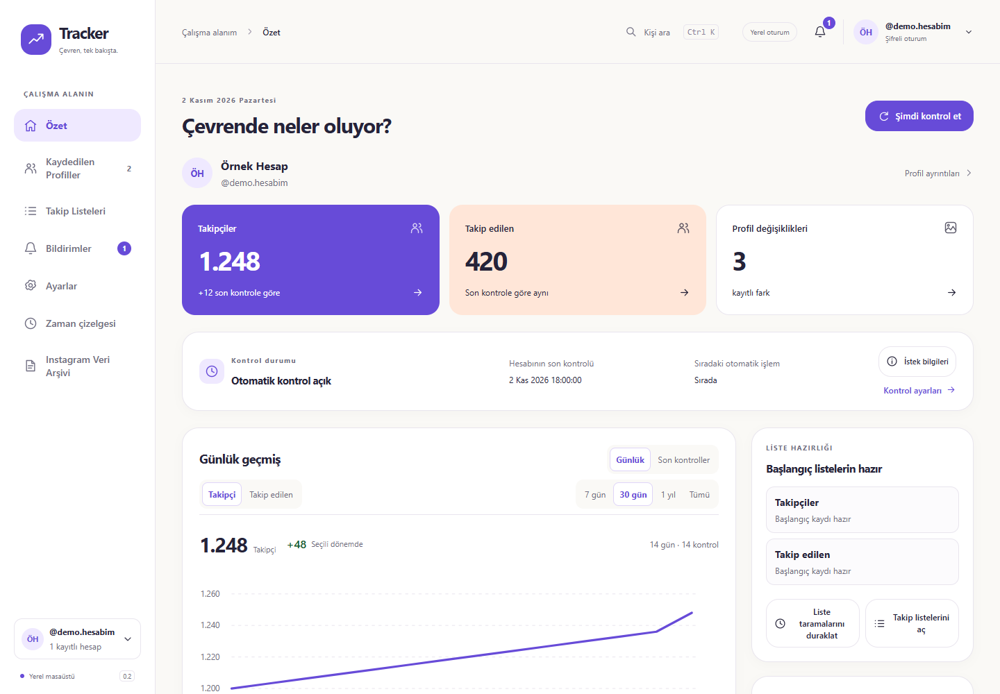

# InstagramTracker Kullanım Kılavuzu

[Türkçe](Home.md) · [English](EN-Home.md) · [Español](ES-Home.md) · [Português (Brasil)](PT-BR-Home.md)

InstagramTracker; takipçi ve takip edilen listelerini karşılaştırmanıza, seçtiğiniz profillerdeki değişiklikleri izlemenize ve kayıtlarınızı cihazınızda incelemenize yardımcı olur.

[İlk kullanım](Ilk-Kullanim.md) · [Kurulum](Kurulum.md) · [Sorun giderme](Sorun-Giderme.md) · [Sürüm durumu](Surum-ve-Destek.md)

> **Geliştirici önizlemesi:** Windows, gerçek yerel veri akışına sahiptir. Android'de giriş sonrası profil okuması üzerindeki sınırlama araştırması sürmektedir. Web, örnek verili bir arayüz önizlemesidir. Ayrıntılar ve doğrulama kapsamı [sürüm durumunda](Surum-ve-Destek.md) yer alır.

*Ekran örneklerinin tamamı sentetik verilerle oluşturulmuştur; gerçek bir hesabı temsil etmez.*

## Nasıl başlamak istersiniz?

- **Arşivinizi inceleyin.** Instagram’dan ZIP indirin, uygulamada açın ve varsa aynı hesaba ait ikinci arşivle karşılaştırın. [Görselli ZIP rehberi](Instagram-Veri-Arsivi.md).
- **Canlı takibi kurun.** Hesabınızı bağlayıp ilk liste kayıtlarının hazırlanmasını bekleyin. Ardından profil ekleyebilir ve bildirim tercihlerinizi seçebilirsiniz. [İlk kullanım rehberi](Ilk-Kullanim.md).

## Kılavuzda neler var?

- [Kurulum ve güncelleme](Kurulum.md): Windows paketi, Android APK'sı ve mevcut kayıtları koruma.
- [İlk kullanım](Ilk-Kullanim.md): İlk bağlantı, ilk liste ve uygulamadaki bölümler.
- [Instagram Veri Arşivi](Instagram-Veri-Arsivi.md): ZIP alma, arşivi açma ve iki dışa aktarımı karşılaştırma.
- [Hesaplar ve giriş](Hesaplar-ve-Giris.md): Kod ekranı, bekleyen bağlantı ve çoklu hesap.
- [Profil takibi](Profil-Takibi.md): Arama, favoriler, notlar, gruplar ve sosyal bağlantılar.
- [Takip listeleri](Takip-Listeleri.md): Başlangıç listesi, yeni/görünmeyen üyeler ve eksik tarama.
- [Otomatik kontrol ve bildirimler](Otomatik-Kontrol-ve-Bildirimler.md): Zamanlama ve arka planda çalışma.
- [Hikâye arşivi](Hikaye-Arsivi.md): İzin verdiğiniz okumalardan yerel takvim ve fotoğraf/video görüntüleme.
- [Günlük istatistikler](Gunluk-Istatistikler.md): Kalıcı gün özetleri, ay/yıl grafikleri ve temizleme.
- [Geçmiş ve analiz](Gecmis-ve-Analiz.md): Zaman çizelgesi, biyografi farkları ve avatar arşivi.
- [Gizlilik ve veriler](Gizlilik-ve-Veriler.md): Yerel şifreleme, yedekler ve dışa aktarımlar.
- [Sorun giderme](Sorun-Giderme.md): Bağlantı, bekleme, liste ve görsel sorunları.
- [Sık sorulan sorular](Sik-Sorulan-Sorular.md): Uygulamanın yapabildikleri ve sınırları.
- [Sürüm ve destek](Surum-ve-Destek.md): Güncel paketler, bilinen açık işler ve hata bildirimi.

## Bu kılavuz nasıl okunmalı?

Platforma özgü adımlar **Windows** veya **Android** etiketiyle belirtilir. Aynı özellik her platformda aynı menüde bulunmayabilir. Ekran görüntüleri Windows arayüzünü gösterir.

Kullanıcı kılavuzu güncel davranışı anlatır. Eski test sonuçları, teknik araştırmalar ve geliştirme notları için [teknik dokümantasyon dizinine](../README.md) bakın. Kılavuzun Wiki'ye aktarılması proje yöneticileri için [ayrı bir sayfada](Wikiye-Tasima.md) açıklanmıştır.

*InstagramTracker, Instagram ve Meta'dan bağımsız bir uygulamadır.*
