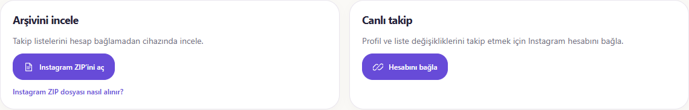

# İlk Kullanım

[Kılavuz ana sayfası](Home.md) · [Instagram Veri Arşivi](Instagram-Veri-Arsivi.md) · [Hesaplar ve giriş](Hesaplar-ve-Giris.md)

Windows 0.2.75 ve Android 0.1.96 itibarıyla **Özet → Instagram ZIP’ini aç** seçeneği, hesap bağlamadan arşiv özetine, veri kategorilerine ve ZIP karşılaştırmasına erişim sağlar. [ZIP’i açma ve karşılaştırma adımları](Instagram-Veri-Arsivi.md).

## 1. Hesabınızı bağlayın

**Hesabını bağla / Hesap bağla** seçeneğini açın. Giriş ve varsa Instagram doğrulamasını tamamlayın. Kayıtlı hesap varken yeni bağlantı için hesap seçiciyi veya bağlantı yönetimini kullanın.

Bağlantının tamamlandığını yalnız giriş formunun kapanmasıyla değerlendirmeyin. Kendi profiliniz ve sayaçlarınız görünmeli; varsa devam veya hata açıklaması incelenmelidir. Android'deki **Bağlantıyı tamamla** durumu [hesaplar sayfasında](Hesaplar-ve-Giris.md#bekleyen-baglantiyi-tamamlamak) açıklanır.

## 2. İlk listeler hazırlanırken

Doğrulanmış yeni bağlantının ardından ilk takipçi ve takip edilen listeleri hazırlık sırasına alınır. Özet'teki **Liste hazırlığı** kartı, hangi yönün hazır olduğunu ve çalışmanın bekleyip beklemediğini gösterir.

- **Hazırlanıyor:** Liste sayfaları okunup kaydediliyordur.
- **Bekliyor:** Bir istek aralığı, bütçe veya Instagram molası vardır.
- **Duraklatıldı:** Hazırlığa devam etmek için kullanıcı işlemi veya ayar değişikliği gerekir.
- **Hazır:** O liste için başlangıç kaydı oluşmuştur.

Önceden kapatılmış otomasyon tercihleri güncellemede kendiliğinden açılmaz. Mevcut hesabın hazırlığı durmuşsa karttaki **Hazırlığa devam et** seçeneğini ve açıklamayı kontrol edin. Bekleme süresi varsa düğme bunu aşmaz.

**İlk liste, uygulamayı kurmadan önce sizi kimin takipten çıktığını göstermez.** Karşılaştırma için önce başlangıç kaydı, daha sonra uygun ikinci liste gerekir. [Liste karşılaştırmasının işleyişi](Takip-Listeleri.md#ilk-kayit-ve-sonraki-karsilastirma).

## 3. Ekranları tanıyın

- **Özet:** Kendi sayaçlarınız, liste hazırlığı ve son değişiklikler.
- **Kaydedilen Profiller:** Özellikle izlemek üzere eklediğiniz kişiler; tüm takipçilerinizin otomatik kopyası değildir.
- **Takip Listeleri:** Seçili hesabın takipçi/takip edilen kayıtları ve karşılaştırmaları.
- **Bildirimler:** Windows'ta kontrol başına gruplanan değişikliklerin uygulama içi kaydı.
- **Zaman çizelgesi:** Kontrolleri ve kaydedilmiş değişiklikleri tarih sırasıyla inceleme.
- **Instagram Veri Arşivi:** ZIP inceleme, içerik takvimi ve iki arşivin karşılaştırılması.
- **Ayarlar:** Platformun sunduğu dil, görünüm, otomasyon ve veri seçenekleri.

## 4. İlk profilinizi kaydedin

**Kaydedilen Profiller → Kişi ekle** yolunu kullanın. Bir ad parçasıyla arayın veya kullanıcı adı/profil bağlantısını girin; doğru hesabı seçip kaydedin. Düzenli kontrol için **İzlemeye al** tercihinin açık olduğunu kontrol edin.

Profil eklemek Instagram'da o kişiyi takip etmez. [Arama ve profil takibi](Profil-Takibi.md).

## 5. Bildirim tercihlerinizi belirleyin

İhtiyacınız olan değişiklikleri seçin. Örneğin kullanıcı adı ve biyografi değişimini bildirip sayaç değişimini sessize alabilirsiniz; ayrıntılı tür tercihleri Windows'ta bulunur.

İşletim sistemi izni ile uygulama içi tercih ayrı ayarlardır. [Otomatik kontrol ve bildirimler](Otomatik-Kontrol-ve-Bildirimler.md).

## Kullanımı kolaylaştıran son ayarlar

Uygulama dilini Türkçe, English, Español veya Português (Brasil) olarak seçebilirsiniz. Sistem, açık, koyu ve OLED görünüm seçeneklerini platformun görünüm ayarından değiştirebilirsiniz. Dil ve tema değişimi Instagram isteği göndermez.

Güncel bir hata varsa tekrar tekrar yenilemek yerine [sorun giderme sayfasından](Sorun-Giderme.md) ilerleyin.
