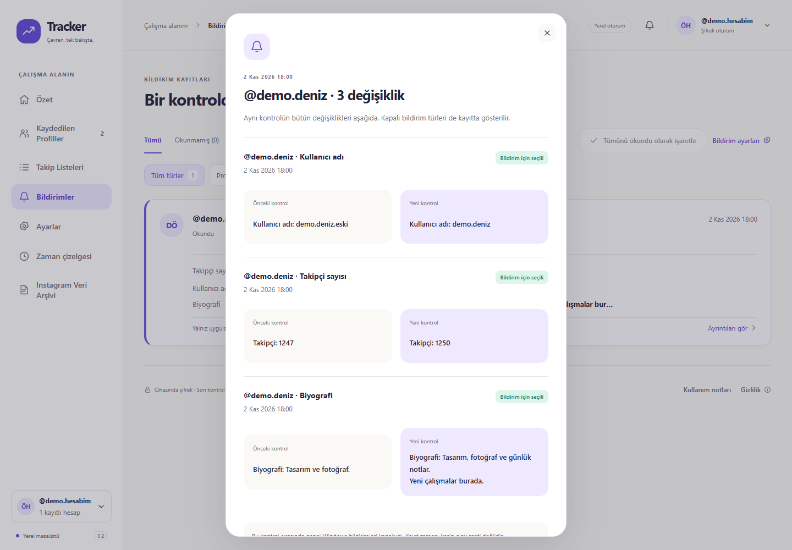

# Otomatik Kontrol ve Bildirimler

[Kılavuz ana sayfası](Home.md) · [Takip listeleri](Takip-Listeleri.md)

## Windows'ta kontrol planı

**Ayarlar → Otomatik profil kontrolü** ve gerekiyorsa **Otomatik liste karşılaştırması** tercihlerini açın. Kaydedilen bir kişi için **İzlemeye al** seçili olmalıdır.

Profil aralığı her hedef için ayrı değerlendirilir. Üç profilin beş dakikalık aralığı, tasarım gereği her birini sırayla on beş dakikada bir kontrol etmek anlamına gelmez. İşler ortak sırayı kullandığından ağ süresi ve yoğunluk yine gecikme yaratabilir.

**Profil aralığı**, aynı hedefi yeniden değerlendirme zamanıdır. **İstek aralığı**, sunucuya giden iki istek arasındaki süredir. **Liste taraması** ise birden fazla sayfa isteği içerebilir. Bu üç süreyi aynı şey olarak düşünmeyin.

Windows ve Android'de normal sayaçlı istekler arasında 6–10 saniyelik rastgele aralık seçilir. Bu, Instagram'ın kabul ettiği güvenli kota veya kesin yanıt süresi değildir. Saatlik/günlük yerel bütçeler ve sunucu sınırlamaları ayrıca uygulanır.

Yerel sınırlar hesap başına **120/saat ve 3.000/24 saat**, aynı cihazdaki hesaplar için toplam **240/saat ve 6.000/24 saat**tir. Otomatik profil işleri aynı hareketli geçmişin %80 eşiğinde ertelenir; listeler ve elle işlemler tam ortak bütçeyi kullanabilir. Bu, her elle işlem için garanti yer olduğu anlamına gelmez. [Teknik politika](../REQUEST-POLICY.md).

## Windows arka planda nasıl çalışır?

Pencereyi kapatmak uygulamayı tepsiye alabilir. Kontrollerin sürmesi için Tracker işlemi, bilgisayar ve ağ bağlantısı çalışıyor olmalıdır.

Tepsi menüsündeki **Tamamen çık** uygulamayı durdurur. Uyku, bilgisayarın kapanması veya internet kesintisi sırasında yeni kontroller ve buna bağlı yeni değişiklik bildirimleri beklenmez.

## Android'in zamanlama farkı

Android arka plan işi 15 dakikalık dönemle planlanır; işletim sistemi pil ve arka plan koşullarına göre daha geç çalıştırabilir. Bu, her hesabın tam 15. dakikada sonuç vereceği garantisi değildir. Açık **Hızlı izle** oturumunun yaklaşık bir dakikalık hedefi, sürekli arka plan çalışmasıyla aynı özellik değildir.

Android bildirim izni ve uygulamadaki ilgili izleme/liste tercihlerini kontrol edin. Telefonun pil yönetimi teslim zamanını etkileyebilir. İşletim sisteminin durdurduğu uygulamada kontrolün kesintisiz sürdüğü varsayılmaz.

Android'de gerçek hesapla uçtan uca veri erişiminin [doğrulama durumu](Surum-ve-Destek.md#android) ayrıca değerlendirilmelidir.

## Bildirim tercihleri

Windows'ta hesap ve değişiklik türü bazında seçim yapabilirsiniz. Örneğin kullanıcı adı ve biyografi değişiklikleri bildirilirken takipçi sayısı değişikliği sessizde tutulabilir.

Aynı kontrolde birden fazla değişiklik varsa tek bildirim grubunda toplanır. **Bildirimler** bölümünden eski ve yeni değerler birlikte incelenebilir. Sessize alınmış türler uygulama içi kayıtta yer alabilir; bir kaydın bulunması Windows'un bildirimi ekranda teslim ettiğini kanıtlamaz.

*Sentetik bildirim örneği. Hesaplar ve değerler gösterim amacıyla üretilmiştir.*

## Bildirim gelmediğinde

1. Yeni bir gözlem ve gerçekten değişiklik oluşmuş mu?
2. Profil izleniyor ve ilgili bildirim türü açık mı?
3. Uygulama ve işletim sistemi bildirim izni etkin mi?
4. Bilgisayar/telefon çalışıyor ve ağ erişimi var mı?
5. Güvenlik molası, ek doğrulama veya dolmuş istek bütçesi var mı?

Önce uygulama içi değişiklik kaydını inceleyin. Bildirimi açmak eski, henüz hiç gözlenmemiş değişiklikleri geriye dönük üretmez. [Bildirim sorun giderme](Sorun-Giderme.md#bildirim-gelmiyor).
