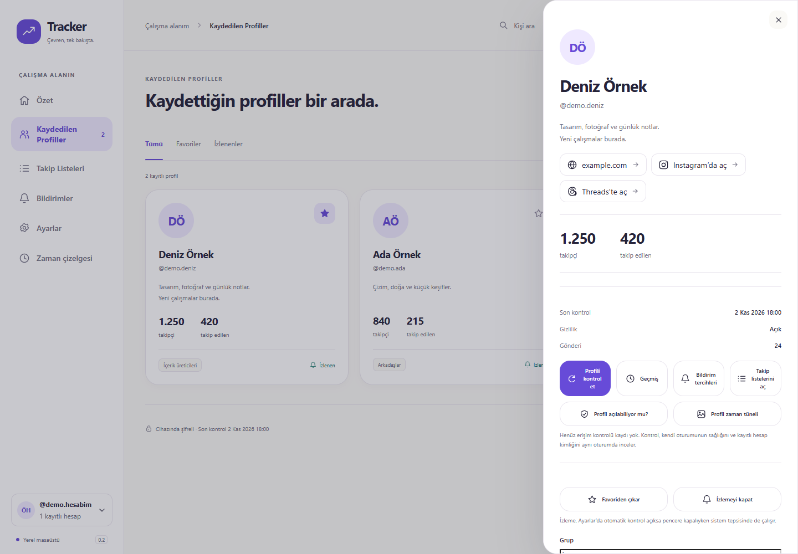

# Profil Takibi

[Kılavuz ana sayfası](Home.md) · [Takip listeleri](Takip-Listeleri.md)

## Kaydedilen profiller ne içindir?

Bu bölüm, özellikle izlemek istediğiniz hesaplardan oluşur. Instagram'daki bütün takipçileriniz burada kendiliğinden listelenmez. Takipçi ve takip edilen üyelerini görmek için **Takip Listeleri** bölümünü açın.

## Profil ekleme

**Kişi ekle → Instagram'da ara** yolunda adın veya kullanıcı adının bir bölümünü yazın. Sonuçtan doğru hesabı seçin. Desteklenen giriş örnekleri:

- `ornek.hesap`
- `@ornek.hesap`
- `https://www.instagram.com/ornek.hesap/`

Profil ekleme araması, kısa bir yazma molasından sonra mevcut istek sırasına girebilir. Arama alanındaki geri sayım, sorgunun sırada olduğunu gösterir. Yazmaya devam ederseniz bekleyen sorgulardan yalnız sonuncusu gönderilir.

**Kaydedilen profillerde arama** ise cihazdaki ad, kullanıcı adı ve grup kayıtlarını filtreler; Instagram'a yeni arama göndermez.

## İzleme, favoriler ve notlar

**İzlemeye al**, profilin düzenli kontrol planına katılmasını sağlar. Favoriler sık açtığınız profilleri bulmanızı kolaylaştırır. Not ve gruplar yalnız uygulamadaki düzenleme araçlarıdır; Instagram profilini değiştirmez.

Bir kişiyi kayıtlarınıza eklemek Instagram'da takip isteği göndermez. Kaydı kaldırmak da Instagram'da takipten çıkmaz.

## Profil panelini okumak

Windows'ta bir liste üyesinin paneli açıldığında eksik/güncel ayrıntılar için tek profil okuması sıraya alınabilir. Yakın zamanda başarıyla alınan ayrıntılar kısa süre yeniden kullanılır. Paneli açmak kişiyi otomatik kaydetmez.

Takipçi/takip edilen sayıları, gönderi sayısı ve gizlilik yalnız alınabildikleri ölçüde gösterilir. Eksik bilgi sıfır veya “açık hesap” olarak tamamlanmaz. Fotoğraf yüklenemezse baş harf gösterilebilir; bu tek başına hesabın kapandığı anlamına gelmez.

*Sentetik profil. Görseller ve bağlantılar özelliklerin sunumunu göstermek içindir.*

## Web siteleri ve Threads

Site bağlantıları yerel simge ve site adıyla gösterilir. Fareyle üzerine gelince tam adres görülebilir; Android'de uzun basma kullanılabilir. Tıklama, adresi normal tarayıcıya devreder.

**Threads'te aç** şu bilgilerden biri varsa gösterilir:

- Instagram profilinden alınan açık bir Threads profil adresi.
- Instagram'ın etkin Threads rozetinde bildirdiği geçerli kullanıcı adı.

Açık adres önceliklidir. Rozet yoksa yalnız Instagram kullanıcı adına bakılarak Threads hesabı varsayılmaz. Düğmenin görünmemesi de “bu kişinin Threads hesabı yok” sonucu değildir. Uygulama düğme için ayrı bir Threads doğrulama sorgusu göndermez.

## Masaüstü klavye kısayolları

- **Ctrl+K** veya **/**: Kayıtlı profil, hesap ve ekranlarda yerel arama paleti.
- **Ctrl+R**: Bulunduğunuz ekranın desteklediği seçili profil yenilemesi.
- **1–5**: Özet, Kaydedilen Profiller, Takip Listeleri, Bildirimler ve Ayarlar.
- **Esc**: En üst paleti, pencereyi veya yan paneli kapatma.

Kısayollar uygulama odaktayken çalışır. Yazı alanı, açık form, devam eden iş veya bekleme durumu yenilemeyi engelleyebilir. **Esc**, devam eden ağ işinin iptal düğmesi yerine geçmez.

İzlenen değişiklikleri incelemek için [Geçmiş ve analiz](Gecmis-ve-Analiz.md) sayfasına geçin.
