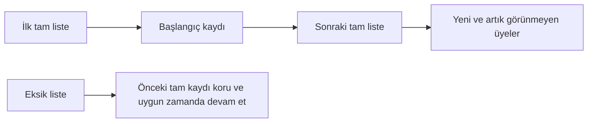

# Takip Listeleri

[Kılavuz ana sayfası](Home.md) · [Otomatik kontrol](Otomatik-Kontrol-ve-Bildirimler.md)

## Instagram ZIP arşivi

**Instagram Veri Arşivi** ekranında hesap bağlamadan ZIP açabilir veya iki dışa aktarımı karşılaştırabilirsiniz. Dosyayı Instagram’dan isteme, arşiv kapsamını okuma ve farkları yorumlama adımları [görselli ZIP rehberindedir](Instagram-Veri-Arsivi.md). Aşağıdaki adımlar takip listelerine odaklanır.

Instagram Hesaplar Merkezi’nde **Bilgilerin ve izinlerin → Bilgilerini dışa aktar** bölümünden Instagram hesabını seçin. Veri seçimi ekranında **Takipçiler ve takip edilenler**, biçim olarak **HTML** veya **JSON**, tarih aralığı olarak **Tüm zamanlar** seçin. Dosya hazır olduğunda ZIP’i cihazınıza indirin. [Meta Hesaplar Merkezi](https://accountscenter.instagram.com/info_and_permissions/).

- Windows’ta ZIP’i **Instagram Veri Arşivi** ekranında açın ve **Takip ilişkileri** düğmesine tıklayın. Açık ZIP kullanılır; dosya yeniden sorulmaz.
- Android’de ana ekrandaki **⋯ → Instagram ZIP yükle** seçeneğini açıp ZIP’i seçin.

Arşivdeki listelerde arama yapabilirsiniz. Son takipten çıktıklarınız, bekleyen ve gelen istekler, yakın arkadaşlar, engellediğiniz ve kısıtladığınız hesaplar da ZIP’te varsa tarihleriyle listelenir; **Seni takip etmeyen yakın arkadaşların** görünümü de vardır. Okunamayan satır olursa pencerede uyarı görünür. İki yön de varsa karşılıklı takipleri, sizi geri takip etmeyenleri ve sizin geri takip etmediklerinizi görebilirsiniz. Eşleşme arşivdeki kullanıcı adlarına göre yapılır. Sonuç, dosyayı oluştururken seçtiğiniz veri ve tarih aralığına bağlıdır.

Takip tarihlerini görmek için JSON biçimini seçin. Arşivdeki tarihli kayıtlar en yeni veya en eski tarihe göre sıralanabilir ve başlangıç ve bitiş günleri dahil olacak şekilde filtrelenebilir. Karşılıklı takiplerde iki yönün tarihi gösterilir. Bu görünümde tarih filtresi, diğer hesabın sizi takip etmeye başladığı tarihi kullanır.

Listeler ekran kapanana kadar bellekte gösterilir. Arşivdeki adlar canlı tarama geçmişine eklenmez. Bu işlem için Tracker’da Instagram oturumu gerekmez.

## Listeyi seçmek

**Takip Listeleri** ekranında önce liste sahibini, ardından **Takipçiler** veya **Takip edilen** yönünü seçin. Kendi hesabınızın ve erişebildiğiniz kaydedilmiş profillerin kayıtlarını ayrı ayrı değerlendirin.

Liste erişimi Instagram'ın verdiği yetkiye ve yanıta bağlıdır. Bir profilin sayaçlarını görebilmek, o profilin bütün takipçi listesini okuyabileceğiniz anlamına gelmez. Tracker, gizli bir profil son tam takip edilen listenizde yoksa ve bu liste son sayaçla uyuşuyorsa liste ekranında takip isteğinin onaylanması gerektiğini açıklar.

## İlk kayıt ve sonraki karşılaştırma

İlk tamamlanan tarama başlangıç kaydıdır. Daha sonra tamamlanan uygun bir tarama, önceki kayıtla karşılaştırılır.

Windows ve Android, yeni kaydedilen bir profil için iki yönü de ilk hazırlık sırasına ekler. Otomatik profil kontrolü ve liste karşılaştırması açıksa hazırlık ortak istek sırasıyla ilerler. İlk kayıt hazır olduktan sonra düzenli tarama için profilin izleniyor olması gerekir.

Örneğin ilk kayıtta A, B ve C; sonraki tam kayıtta A, C ve D varsa uygulama B'nin artık görünmediğini ve D'nin yeni göründüğünü belirleyebilir. Bu, iki kontrol arasındaki net farktır. Olayın kesin saati veya aradaki bütün hareketler bilinmez.

Uygulamayı kullanmaya başlamadan önceki takipten çıkışlar bu yöntemle geriye dönük bulunamaz.

## Büyük listeler nasıl okunur?

Listeler sayfa sayfa alınır. Bir sayfanın bitmesi bütün listenin bitmesi değildir. Ekranda okunan üye/sayfa sayısı, devam durumu ve varsa bekleme açıklaması gösterilir.

Küçük bir listede tek sayfa yeterli olabilir. Büyük bir listede bağlantı, kuyruk, istek aralıkları ve bütçe toplam süreyi uzatır. Profil sayısı değişirken yapılan bir taramada beklenen ve okunan sayılar da uyuşmayabilir.

## Eksik listeyi anlamak

**“Liste henüz tamamlanmadı”** veya **“Okunan liste ile profilindeki sayı uyuşmadı”** açıklaması, eksik verinin tam liste gibi kabul edilmediğini gösterir.

- Önceki tamamlanmış liste korunur.
- Geçerli devam bilgisi varsa tarama uygun sayfadan sürdürülebilir.
- Devam bilgisi kullanılamıyorsa yeni tarama baştan başlayabilir; eski ve yeni kısmi üyeler tek bir tam liste gibi birleştirilmez.
- Eksik listeden kesin takipten çıkan hesabı sonucu üretilmez.

Yeni kaydedilen bir profilin ilk listesi sayı uyuşmazlığıyla biterse yaklaşık 30 dakika sonra bir erken tekrar planlanır. Uyuşmazlık sürerse günlük plan geçerli olur. Profilde yeni bir sayı gözlenmesi, kota ve Instagram molası sonraki denemeyi etkileyebilir.

Ekrandaki devam veya tekrar zamanını izleyin. Listeyi sonsuza kadar durmadan sorgulamak yerine eksik durum görünür bırakılır. [Eksik liste için sorun giderme](Sorun-Giderme.md#liste-tamamlanmiyor).

## Kimin geldiğini veya gittiğini görmek

Windows'ta iki uygun tam liste oluştuğunda karşılaştırma alanını kullanın. Liste değişikliği kaydından **Değişen hesapları gör** ile ilgili üyeler açılabilir. Kayıt kapsamı yeterliyse geri takip etmeyenler gibi iki yönlü liste karşılaştırmaları da yapılabilir.

Windows’ta kendi hesabınızın **Takip edilen → Seni geri takip etmeyenler** filtresini açın ve satırın **⋯** menüsünü kullanın. Android’de kendi hesabınızın **Takip Listeleri → Karşılaştır → Seni geri takip etmeyenler** sonucunda bir hesaba dokunun. **İstisnalara taşı**, hesabı listenin sonundaki **İstisnalar** bölümüne alır. Bu hesaplar ana sonuç sayısına dahil edilmez. **Ana listeye geri al** ile tercih geri alınabilir.

Yalnız “takipçi sayısı 1 azaldı” bilgisi, giden kişinin kimliğini vermez. Üye adları için ilgili listelerin okunması gerekir.

## Geri gelenler ve ayrılanlar

Windows 0.2.91’den itibaren her tam liste taraması kalıcı bir takip geçmişine eklenir. **Takip Listeleri → İlişki filtresi** içinden:

- **Geri gelenler:** Listeden çıkıp sonradan yeniden görülen hesaplar. Satırda geri dönüş zamanı, önceki çıkış aralığı ve ilk görülme yazar.
- **Ayrılanlar:** Son tam listede olmayan hesaplar. Son görülme ve listeden çıkış aralığı yazar. Eski taramalar döndükçe kaybolmazlar.

Bir kişiye tıklayınca açılan panelde **Takip geçmişi** bölümü, senin takipçi ve takip ettiğin listelerinde bu kişinin hareketlerini gösterir. Normal listede son taramada geri dönen hesabın rozeti **Geri döndü** olur.

Zamanlar iki tam tarama arasıdır: “13 Kas – 14 Kas arası listeden çıktı”, kişinin 13 Kasım taramasında olup 14 Kasım taramasında olmadığını söyler. Kesin saat bilinmez. İlk tam listede zaten olan kişi için “ilk tam listede vardı” yazar; daha önceki takip tarihi bilinmez. Kısmi taramalar geçmişi değiştirmez. Yeni Instagram isteği gönderilmez. [Ayrıntılar](../FOLLOW-HISTORY-TEST.md).

## Ortak takipçiler ve takip edilenler

**Takip Listeleri** ekranında liste sahibini seçin. **Ortak hesapları karşılaştır** alanından ikinci profili seçin. **Ortak takipçiler** iki profili de takip edenleri, **Ortak takip edilenler** iki profilin de takip ettiği hesapları gösterir.

Tracker her profil için son tam listeyi kullanır. Tam liste yoksa varsa kısmi kayıtla karşılaştırır ve sonucu **Okunan hesaplar arasında** olarak etiketler. Ekranda iki listenin kayıt tarihi ve kapsamı görünür. Bir kaynak eksikse ortak hesap sayısı yerine kayıt eksikliği gösterilir. Arama ve karşılaştırma cihazda yapılır. Satırlarda eldeki profil fotoğrafı ve bilinen takipçi/takip edilen sayıları görünür. Fotoğraf önbellekte yoksa görsel bağlantısı kullanılabilir. Karşılaştırma satırları otomatik profil sorgusu başlatmaz.

## Otomatik yeni taramalar

Windows'ta otomatik profil kontrolü ve otomatik liste karşılaştırması açıkken kendi hesabınız ve izlenen profiller değerlendirilir. Sayaç değişimi ilgili listeyi öne alabilir. Sayı aynı kalsa da günlük tam kontrol hedefi korunur; bir kişi çıkıp başka biri eklendiğinde toplam sayı değişmeyebilir.

Bu hedefler mevcut istek sırası ve beklemelerle uygulanır. Bir dakikalık profil kontrolü seçmek, bütün listeyi her dakika baştan okuma sözü değildir.

## Arama ve fotoğraflar

Windows'ta liste kaydırıldıkça sonraki 100 kişilik bölüm cihazdaki kayıttan yüklenir; “Daha fazla göster” düğmesine basmanız gerekmez. Bu işlem yeni Instagram liste isteği göndermez.

Liste içindeki arama, cihazda kaydedilmiş listenin tamamında çalışır; ekranda henüz gösterilmeyen üyeleri de bulur. Instagram'dan henüz okunup kaydedilmemiş üyeleri kendiliğinden bulmaz. Fotoğraflar ayrı yüklenir. Görselin gelmemesi üyenin listede bulunmadığı anlamına gelmez.

Liste üyesini özel takibe almak için kaydetme/izleme eylemini ayrıca kullanın. Panelin açılması bu tercihi otomatik değiştirmez.
