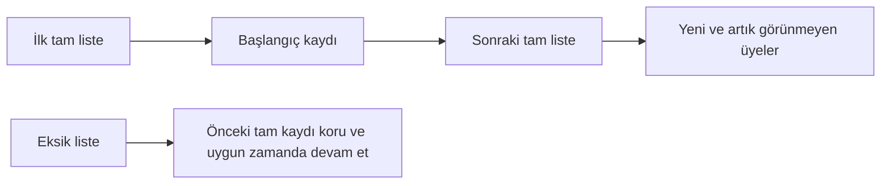

# Takip Listeleri

[Kılavuz ana sayfası](Home.md) · [Otomatik kontrol](Otomatik-Kontrol-ve-Bildirimler.md)

## Listeyi seçmek

**Takip Listeleri** ekranında önce liste sahibini, ardından **Takipçiler** veya **Takip edilen** yönünü seçin. Kendi hesabınızın ve erişebildiğiniz kaydedilmiş profillerin kayıtlarını ayrı ayrı değerlendirin.

Liste erişimi Instagram'ın verdiği yetkiye ve yanıta bağlıdır. Bir profilin sayaçlarını görebilmek, o profilin bütün takipçi listesini okuyabileceğiniz anlamına gelmez.

## İlk kayıt ve sonraki karşılaştırma

İlk tamamlanan tarama başlangıç kaydıdır. Daha sonra tamamlanan uygun bir tarama, önceki kayıtla karşılaştırılır.

Windows, yeni kaydedilen bir profil için iki yönü de ilk hazırlık sırasına ekler. Otomatik profil kontrolü ve liste karşılaştırması açıksa hazırlık ortak istek sırasıyla ilerler. İlk kayıt hazır olduktan sonra düzenli tarama için profilin izleniyor olması gerekir.

Örneğin ilk kayıtta A, B ve C; sonraki tam kayıtta A, C ve D varsa uygulama B'nin artık görünmediğini ve D'nin yeni göründüğünü belirleyebilir. Bu, iki kontrol arasındaki net farktır. Olayın kesin saati veya aradaki bütün hareketler bilinmez.

Uygulamayı kullanmaya başlamadan önceki takipten çıkışlar bu yöntemle geriye dönük bulunamaz.

## Büyük listeler nasıl okunur?

Listeler sayfa sayfa alınır. Bir sayfanın bitmesi bütün listenin bitmesi değildir. Ekranda okunan üye/sayfa sayısı, devam durumu ve varsa bekleme açıklaması gösterilir.

Küçük bir listede tek sayfa yeterli olabilir. Büyük bir listede bağlantı, kuyruk, istek aralıkları ve bütçe toplam süreyi uzatır. Profil sayısı değişirken yapılan bir taramada beklenen ve okunan sayılar da uyuşmayabilir.

## Eksik listeyi anlamak

**“Liste henüz tamamlanmadı”** veya **“Okunan liste ile profilindeki sayı uyuşmadı”** açıklaması, eksik verinin tam liste gibi kabul edilmediğini gösterir.

- Önceki tamamlanmış liste korunur.
- Geçerli devam bilgisi varsa tarama uygun sayfadan sürdürülebilir.
- Devam bilgisi kullanılamıyorsa yeni tarama baştan başlayabilir; eski ve yeni kısmi üyeler tek bir tam liste gibi birleştirilmez.
- Eksik listeden kesin takipten çıkan hesabı sonucu üretilmez.

Yeni kaydedilen bir profilin ilk listesi sayı uyuşmazlığıyla biterse yaklaşık 30 dakika sonra bir erken tekrar planlanır. Uyuşmazlık sürerse günlük plan geçerli olur. Profilde yeni bir sayı gözlenmesi, kota ve Instagram molası sonraki denemeyi etkileyebilir.

Ekrandaki devam veya tekrar zamanını izleyin. Listeyi sonsuza kadar durmadan sorgulamak yerine eksik durum görünür bırakılır. [Eksik liste için sorun giderme](Sorun-Giderme.md#liste-tamamlanmiyor).

## Kimin geldiğini veya gittiğini görmek

Windows'ta iki uygun tam liste oluştuğunda karşılaştırma alanını kullanın. Liste değişikliği kaydından **Değişen hesapları gör** ile ilgili üyeler açılabilir. Kayıt kapsamı yeterliyse geri takip etmeyenler gibi iki yönlü liste karşılaştırmaları da yapılabilir.

Yalnız “takipçi sayısı 1 azaldı” bilgisi, giden kişinin kimliğini vermez. Üye adları için ilgili listelerin okunması gerekir.

## Otomatik yeni taramalar

Windows'ta otomatik profil kontrolü ve otomatik liste karşılaştırması açıkken kendi hesabınız ve izlenen profiller değerlendirilir. Sayaç değişimi ilgili listeyi öne alabilir. Sayı aynı kalsa da günlük tam kontrol hedefi korunur; bir kişi çıkıp başka biri eklendiğinde toplam sayı değişmeyebilir.

Bu hedefler mevcut istek sırası ve beklemelerle uygulanır. Bir dakikalık profil kontrolü seçmek, bütün listeyi her dakika baştan okuma sözü değildir.

## Arama ve fotoğraflar

Windows'ta liste kaydırıldıkça sonraki 100 kişilik bölüm cihazdaki kayıttan yüklenir; “Daha fazla göster” düğmesine basmanız gerekmez. Bu işlem yeni Instagram liste isteği göndermez.

Liste içindeki arama, cihazda kaydedilmiş listenin tamamında çalışır; ekranda henüz gösterilmeyen üyeleri de bulur. Instagram'dan henüz okunup kaydedilmemiş üyeleri kendiliğinden bulmaz. Fotoğraflar ayrı yüklenir. Görselin gelmemesi üyenin listede bulunmadığı anlamına gelmez.

Liste üyesini özel takibe almak için kaydetme/izleme eylemini ayrıca kullanın. Panelin açılması bu tercihi otomatik değiştirmez.
